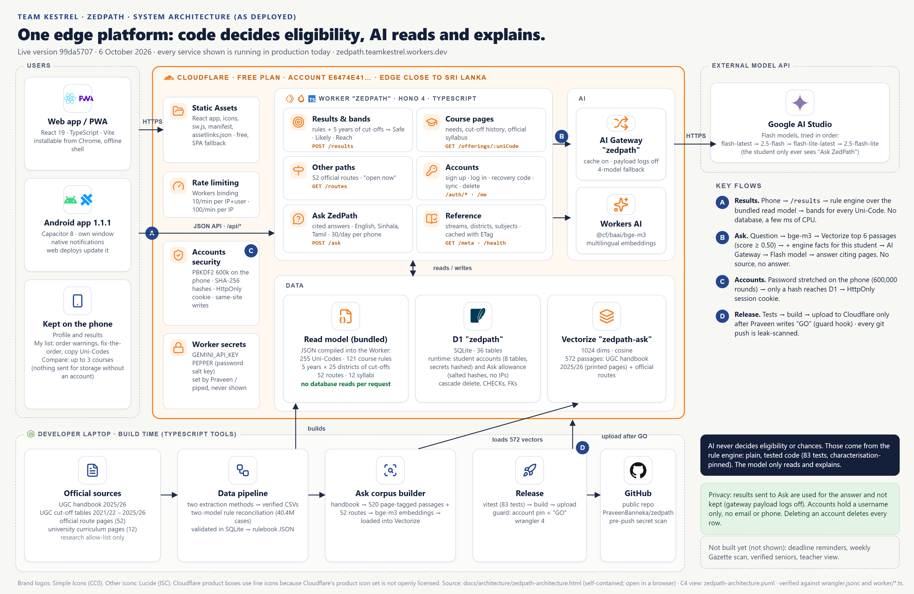

# ZedPath

**Everything after A/Ls, in one place.**

ZedPath helps a Sri Lankan student between A/L results and their next step. You enter your results
once and see every path you can actually reach: state university courses, private degrees,
gazetted job exams, vocational courses, study abroad and a retry. Each one comes with its deadlines
and with answers that link back to the official page they came from.

Free, mobile-first, in Sinhala, Tamil and English.

> Web app (works on any phone; installable) and an Android app built with
> Capacitor (`native/`). Built for the IntelliCon '26 Buildathon (Team Kestrel, Education domain). Gate 1 (Problem &
> Proof) submitted; Gate 3 final due 11 Oct 2026. See [Roadmap](#roadmap).

---

## The problem

In 2025, **281,810** students sat the A/L. **176,527** qualified for university, and there were
only **42,937** state university places.<sup>1</sup>

Within a few weeks of results, every one of them has to decide:

- **State university:** rank up to 125 course choices under rules in a 200+ page UGC handbook that
  changes every year, inside a three-week application window.
- **Everything else:** private degrees, study abroad, gazetted job exams such as Customs, vocational
  courses, or sitting again. Each runs on its own website, notices and calendar.

Most students decide from tuition teachers, seniors and Facebook groups. A badly ordered preference
list, an ineligible choice, a missed aptitude test or a path they never heard of can cost them a year.

We interviewed six people at six points on this path. One pattern came through: **nobody knew where
to look.**

> "I didn't have a proper way to find out, like about the Gazette." (E3, now applying for the Customs exam)
>
> "I missed one course... life altering situation." (E4, on a preference list)
>
> "Basically it's luck." (E5, on finding a foreign scholarship)

We hands-on tested the existing cut-off tools (findmydegree.lk, Unicompass, induwara.lk) and
reviewed ThuSh LK. All of them compare Z-scores with cut-offs. **None checks subject grade rules,
preference order or deadlines, and none covers routes outside the UGC.**

## What ZedPath does

| | Feature | What it means for the student | Status |
|---|---|---|---|
| 1 | **Results in, paths out** | Stream, district, Z-score and grades, plus sports and achievements ("beyond grades"). Subjects and courses are searchable. | ✅ Live |
| 2 | **Very likely / Possible / Unlikely** | All 255 Uni-Codes banded against **five years** of official district cut-offs, with a trend, a cut-off chart and a one-line meaning for each band. | ✅ Live |
| 3 | **Fine-print check** | Subject and minimum-grade rules for all 121 courses from the handbook. Hidden courses always say *why*, with the page. | ✅ Live |
| 4 | **My list (preference checker)** | Warns when a Very likely course sits above a Possible/Unlikely one or when there is no Very likely course; proposes a fixed order; copies Uni-Codes. | ✅ Live |
| 5 | **Compare and syllabi** | Up to 3 courses side by side; "What you'll study" from the university's own curriculum (12 programmes so far). | ✅ Live |
| 6 | **Every other route** | 52 official routes: private degrees, HNDs, professional bodies, vocational (with the NVQ 5/6 → B.Tech ladder at UoVT), job exams, scholarships abroad, with "open now". | ✅ Live |
| 6a | **University facts** | On every course page: students admitted, undergraduates, hostel places and graduates, from the UGC's *Sri Lanka University Statistics 2024*, each with its table and page. | ✅ Live |
| 6b | **Aptitude tests** | The 24 courses that need one: the official notice and last intake's dates (shown as past), or the joint test to apply for. | ✅ Live |
| 7 | **Ask ZedPath, with sources** | Questions in English, Sinhala or Tamil, answered only from the UGC handbook and official routes, citing the page, using *your* results. | ✅ Live |
| 8 | **Accounts and demo** | **Try the demo**: one tap opens a private throwaway account with a sample student (read-only in groups, deleted after 24 hours). Accounts: required at the start: username + password, full name, email, Sri Lankan mobile and date of birth, each with its purpose shown and consent recorded; recovery code; same details on any device. Email and mobile are not verified yet. | ✅ Live |
| 9 | **Journey and reminders** | The student's own checklist, saved to their account: steps unlock when their window opens (never on an invented date); followed courses and notices with phone reminders (Android) or a calendar file. | ✅ Live |
| 10 | **Alerts (Journey › Open now)** | Gazette job exams and other intakes with closing dates, checked against the student's results and age; follow one to track it. | ✅ Live |
| 11 | **Groups** | A live group per target course and per A/L batch; rules accepted once; group info with members; preset avatars; verified seniors (invite codes); automatic moderation, report and block. | ✅ Live |
| 12 | **Three languages** | The whole interface in Sinhala, Tamil and English (AI translation, native-speaker review pending); official names and quotes as published. | ✅ Live |
| 13 | **Gazette watch** | Weekly automatic scan of Government Gazette notices (today the notices are added by hand from the Gazette). | Planned |

Concept screens (33 screens, one student's whole journey):
**[ZedPath mobile preview](https://claude.ai/artifact/N8wGu87fiY8ksUbb82yU8f)**. These are illustrative, with sample data.

## Why it needs AI

| Job | Without AI | With AI | Status |
|---|---|---|---|
| Turn the handbook into rules | 121 courses re-coded by hand every year | Each entry clause encoded as a rule **with its page**, by two independent encodings compared over 40.4 million student cases; the 5 disagreements resolved against the handbook (`data/rules/RECONCILIATION.md`) | ✅ Done for 2025/26 |
| Answer "can I, with my grades?" | A fixed FAQ can't | **Ask ZedPath**: multilingual search (Workers AI bge-m3 + Vectorize) finds the handbook pages, ZedPath's own rule engine checks the student's results, a language model writes the answer citing the pages | ✅ Live |
| Watch the Gazette | Someone reads every notice every week, and still misses some | Weekly scan classifies notices and extracts exam, eligibility and closing date | Planned |

**How it stays honest:** every rule and answer cites its source page. Eligibility and chances always come from
the tested rule engine, never from the language model's guess. Ask answers only from the handbook and official
routes, says "not found" otherwise, and never promises admission. Retrieval was calibrated on hand-checked
questions in all three languages.

## Architecture

As deployed, checked against `wrangler.jsonc` and `worker/*.ts`
([interactive page](docs/architecture/zedpath-architecture.html) ·
[C4 container view](docs/architecture/zedpath-architecture.png) from
[PlantUML source](docs/architecture/zedpath-architecture.puml)):



In short:

- **One Cloudflare Worker** (`zedpath`, Hono + TypeScript) serves the API; the React app is free static assets.
- **Results need no database reads:** cut-offs, rules, routes and syllabi are compiled into a read model bundled
  inside the Worker, so a full eligibility check costs a few milliseconds of CPU on the free plan.
- **D1** holds only what must persist: student accounts (secrets stored as hashes; contact details in their own table),
  groups, invites, reports and blocks, and Ask's daily allowance (salted hashes, no IPs). Group messages live in one
  Durable Object per group.
- **Ask ZedPath:** Workers AI (bge-m3) embeds the question → Vectorize returns the closest of 572 handbook/route
  passages → the rule engine adds the student's own facts → the model answers through **AI Gateway** (cache on,
  payload logs off) with a fallback chain across four Flash models.
- **Clients:** the PWA, and a native Android app (Capacitor) that loads the live site in its own window and posts
  native notifications, so every web deploy also updates the app.
- **Delivery:** deploys come from the developer laptop only, blocked by a guard unless the Cloudflare account pin
  matches and the owner has given an explicit GO; every push to this public repo is scanned for secrets.

## Tech stack

| Layer | Choice | Why |
|---|---|---|
| App | React 19 + TypeScript, Vite, motion, PWA | Mobile-first, installable, small (141 KB JS gzip, within the 200 KB budget NFR-006); TypeScript everywhere |
| API | Hono 4 on Cloudflare Workers (+ Static Assets) | One Worker, free static hosting; Next.js SSR risked the free plan's 10 ms CPU limit (ADR in ZP-DOC-06) |
| Read model | Rulebook JSON compiled from the validated SQLite schema | Zero database reads per student request |
| Data | Cloudflare D1 (42-table schema; accounts, groups and allowance at runtime) + Durable Objects (group rooms) | Foreign keys, CHECK constraints, cascade delete |
| Ask | Workers AI (bge-m3), Vectorize, AI Gateway, Google Flash models | Multilingual retrieval, caching and analytics, cited answers |
| Protection | Workers Rate Limiting, PBKDF2 on the device, hashed sessions | Brute-force and privacy protection within the free plan |
| Android | Capacitor 8 (`native/`) | Native window and notifications; web deploys update the app |
| Tests | Vitest (553 tests) plus agent-run end-to-end harnesses (API, browser, security, accessibility, offline, layout, live read-only); results in tools/e2e/results | Rules and accounts proven, not assumed |

Everything runs on Cloudflare's free plan, so a student on mobile data gets answers quickly and the project
costs nothing until it grows.

## Roadmap

| Stage | Scope | Status |
|---|---|---|
| **Gate 1: Problem & Proof** | Six interviews, tool test, market sizing, first rules and dates collected by hand | ✅ Submitted |
| **Core flow** | Results once → 255 Uni-Codes banded from five years of official cut-offs → 52 other routes → course pages with sources, cut-off charts and syllabi → public link | ✅ Live |
| **Applying** | My list with order checks ✅ · Compare ✅ · accounts ✅ · Journey and reminders ✅ · Alerts ✅ · Groups ✅ | ✅ Live |
| **AI and depth** | Handbook → rules (two-model reconciled) ✅ · Ask ZedPath with cited pages in three languages ✅ · weekly Gazette scan | 🔨 Building |
| **Apps** | Installable PWA ✅ · native Android app (Capacitor) ✅ · Google Play (internal testing first) | 🔨 Building |
| **People and money** | Verified seniors ✅ · Sinhala/Tamil interface ✅ · email and SMS verification and reminders (needs a domain and an SMS service) · family share card, teacher view | 🔨 Building |

## Engineering documentation

ZedPath is documented the way a software company would document it: one controlled set, written in
dependency order, each document following a named international standard, with document control, revision
history, approval, numbered requirements and full traceability from interview evidence to test case.
Each document is available as Markdown (source), Word and PDF.

| ID | Document | Standard | Status |
|---|---|---|---|
| [ZP-DOC-00](docs/00-documentation-standard/) | Documentation Standard | ISO/IEC/IEEE 15289:2019 | v1.0 approved |
| [ZP-DOC-01](docs/01-vision-and-scope/) | Vision and Scope | Wiegers and Beatty template | v2.1 approved |
| [ZP-DOC-02](docs/02-user-stories/) | User Stories (72 active stories) | Cohn, INVEST, MoSCoW | v2.1 approved |
| [ZP-DOC-03](docs/03-requirements/) | Software Requirements Specification (148 FR, 54 NFR, 66 business rules) | ISO/IEC/IEEE 29148:2018 | v2.1 approved |
| [ZP-DOC-04](docs/04-use-cases/) | Use Case Model (35 use cases) | UML 2.5.1, Cockburn | v2.1 approved |
| [ZP-DOC-05](docs/05-data-design/) | Data Design (EER → relational → normalisation → D1), incl. student accounts | Elmasri and Navathe EER | v0.9 in review |
| [ZP-DOC-06](docs/06-architecture/) | Software Architecture | ISO/IEC/IEEE 42010, C4, ADRs | v0.9 in review |
| [ZP-DOC-07](docs/07-ui-ux/) | UI/UX Specification | Material Design 3, WCAG 2.2 AA | v0.9 in review |
| [ZP-DOC-08](docs/08-test-plan/) | Test Plan + Test Summary Report (1,053 executed cases) | ISO/IEC/IEEE 29119-3 | v0.9 in review |

The documents are built from Markdown by a small TypeScript tool ([docs/_build](docs/_build/)).

## Trust rules (built into the product)

- **Official numbers only.** Every cut-off comes from the UGC's published tables and links to its source.
- **Honest about uncertainty.** It never says "you will get in". Past cut-offs describe the past, and the app says so.
- **No paid placement.** No institute can pay to appear in results or look more recognised than it is.
- **Only what is needed, with consent.** An account is required. It asks for a username, full name, email, mobile and date of birth, says why each is needed, and records consent (Sri Lanka's Personal Data Protection Act, No. 9 of 2022; a parent or guardian agrees for students under 18). Contact details are kept apart from results, never sold, never shown to other students, and deleted with the account.

## Running locally

```
npm install
npx wrangler d1 migrations apply zedpath --local   # local copy of the database (accounts, allowance)
npm run dev                                         # Vite + the Workers runtime at http://localhost:5173
npm test                                            # 553 tests (21 perf tests opt-in with PERF=1)
```

Accounts need a local `PEPPER=<random hex>` line in `.dev.vars` (gitignored). Ask ZedPath also needs
`GEMINI_API_KEY` and uses the real Workers AI and Vectorize from local dev. The Android app: see
[native/README.md](native/README.md).

### Repo safety (for contributors)

This repo is public. Two automatic guards protect it:

- `.githooks/pre-push`: scans every pushed commit for API keys, tokens, private keys and `.env`/`.dev.vars`
  files, and blocks the push on a hit. Enable it once per clone: `git config core.hooksPath .githooks`
- `.claude/hooks/zedpath-guard.cjs`: an AI-assistant guard. It blocks deploys and other live changes
  without the owner's explicit go-ahead and the correct, pinned Cloudflare account.
  Tests: `bash .claude/hooks/test-guard.sh`

Secrets live in `.dev.vars` locally (gitignored) and in Cloudflare secrets in production. They are never committed.

## Team

**Team Kestrel** · B.M.P Banneka (solo, undergraduate bracket), with Claude (Anthropic) as coding partner.

## Credits

Profile pictures: 12 plain silhouettes in different colours, drawn for ZedPath (`tools/avatars/make-avatars.ts`, no third-party artwork) and served as static files.

## Disclaimer

ZedPath is an independent project. It is not affiliated with the University Grants Commission, the
Department of Examinations, or any university or institute. Cut-offs and rules come from the UGC's official
2021/22 to 2025/26 tables and the 2025/26 handbook, verified and cited, but ZedPath can still be wrong: always
confirm on the UGC application. Past cut-offs describe the past, and final selection is always decided by the UGC.

---

<sup>1</sup> Department of Examinations, G.C.E. (A/L) 2025 results; UGC University Admission 2025/26.
See also: National Education Commission, *Study on Career Guidance in General Education in Sri Lanka*,
Research Series No. 08 (2014).
