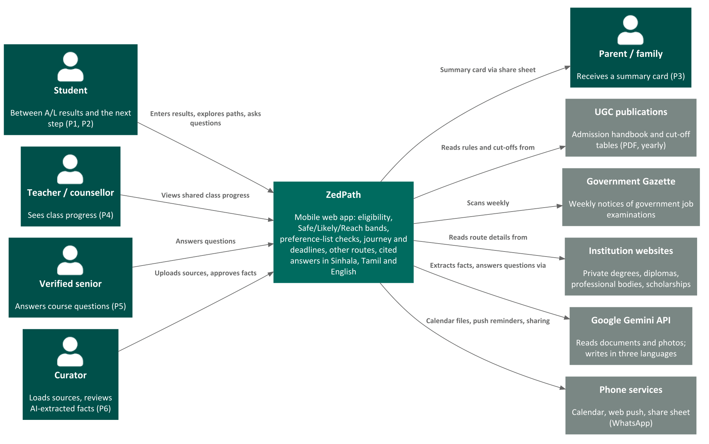

# Introduction

## Purpose

This document states **why** ZedPath is being built, **what** it will and will not do, and **how** its success
will be judged. It is the parent of every other ZedPath document: user stories (ZP-DOC-02) refine its features,
and the requirements specification (ZP-DOC-03) makes them precise.

## Scope

It covers the business requirements, the product vision, the scope of the first two releases, and the
business context (stakeholders, priorities, risks and deployment constraints). Technical design is out of scope.

## Intended audience

The product owner, buildathon judges and mentors, and anyone deciding whether ZedPath is worth building.

## Relationship to other documents

Table: Position of this document in the ZedPath document set

| Document | Relationship |
|---|---|
| Gate 1 Problem and Proof deck | Source. Evidence, market sizing and the three-week plan come from it |
| ZP-DOC-02 User Stories | Child. Each feature FE-n below is refined into the stories of epic EPn |
| ZP-DOC-03 Software Requirements Specification | Child. Business objectives become measurable quality requirements |
| ZP-DOC-06 Software Architecture | Child. The deployment constraints below bind the architecture |

## Changes since version 1.0

After v1.0 was approved on 5 October 2026, the product owner approved six change requests and the changes from a
video review of the live app. Items they changed are marked *Revised* below; ZP-DOC-02 and ZP-DOC-03 hold the detail.

Table: Change requests that affect the vision and scope

| CR | Date | What changed in scope |
|---|---|---|
| CR-001 | 5 October 2026 | Student accounts (username and password, key derived on the phone, recovery code); the profile follows the student across devices; delete account |
| CR-002 | 11 October 2026 | Journey with reminders (phone notifications in the Android app, calendar file elsewhere); Alerts for Gazette and intake notices, checked on the phone; course and A/L-batch groups with verified seniors and moderation; navigation Paths, My list, Journey, Groups, Ask |
| CR-003 | 11 October 2026 | An account is **required** at the start, with full name, email, Sri Lankan mobile and date of birth, each with its purpose and recorded consent (Personal Data Protection Act, No. 9 of 2022) |
| CR-004 | 11 October 2026 | Ask answers as a card: verdict, sources, next steps from ZedPath's data, follow-ups and feedback |
| Video review | 11 October 2026 | Sinhala and Tamil interface; search; Compare of up to three courses; chart values; achievements used in Ask; reminder settings; "Sit the A/L again" path removed; selecting several courses at once |
| CR-005 | 11 October 2026 | Group rules before taking part; no phone numbers or emails in messages; popular groups; labelled sample conversations |
| CR-006 | 11 October 2026 | Group rules once per account; group info page; preset avatars; the student ticks Journey steps within their windows; follow courses and notices; Journey saved on the account; Alerts become the Journey's *Open now* tab |

## Changes since version 2.0

*New in v2.1 (draft).* After v2.0 was approved on 14 October 2026, the product owner made the decisions below. They add to
the scope without withdrawing any v2.0 commitment. Items they changed are marked *Revised (CR-nnn)* or *(VR2)* below;
ZP-DOC-02 and ZP-DOC-03 hold the detail.

Table: Change requests since version 2.0

| CR | Date | What changed in scope |
|---|---|---|
| VR2 | 14 October 2026 | Product owner's review and decisions: the bands are shown as **Very likely**, **Possible** and **Unlikely** (internal codes SAFE, LIKELY and REACH unchanged) with a one-line meaning under the tabs; the intro guide has seven slides; preset avatars are plain silhouettes in 12 colours; an expired session returns to *Log in* |
| CR-007 | 15 October 2026 | *Try the demo*: one tap on the Welcome screen opens a private throwaway account holding the sample student, without sign-up; it is deleted 24 hours later; demo accounts read groups but cannot create groups, report or post |
| CR-008 | 15 October 2026 | University facts on the course page from the UGC report *Sri Lanka University Statistics 2024*: students admitted 2023/24, undergraduates 2024, permanent hostel places, Mahapola and Bursary recipients, graduates 2024 (provisional), each citing its table and page |
| CR-009 | 15 October 2026 | Aptitude tests on the course page for all 24 offerings that need one, with the last intake's official notice and dates shown as past; the NVQ Level 5/6 to NVQ Level 7 (degree) ladder added to the University of Vocational Technology route |
| CR-010 | 15 October 2026 | Security hardening from the first security audit (run-1) and the test campaign: open group chats close when the session ends or the member leaves; deleting an account removes its messages from every group it ever opened; a shared Ask link never spends questions; no demo password in the app; the next student on a shared phone never inherits the previous student's data; disguised phone numbers, emails and chat-invite links refused in groups; fresh and demo accounts cannot hide messages by reporting; per-account, per-network and whole-service limits; cross-site and malformed requests refused |

# Business requirements

## Background

Every year about 275,000 students sit the G.C.E. Advanced Level (A/L) examination in Sri Lanka. In 2025,
**281,810** sat the examination, **176,527** qualified for university admission, and there were **42,937**
state-university places for the 2025/26 intake [1][2].

Within a few weeks of results, each student must decide. Students aiming for a state university must choose
and rank up to 125 course preferences under rules published in a handbook of more than 200 pages that changes
every year, inside a three-week application window. Because places are limited, most also need a backup:
a private or non-state degree, study abroad, a government job examination announced in the Gazette, a
vocational course, or sitting the examination again. Each path has its own rules, calendar and website.

Gate 1 research (six interviews, E1 to E6, and a hands-on test of four existing tools, T1) found one pattern:
students decide mostly on hearsay from tuition teachers, seniors and social-media groups. A badly ordered
preference list, an ineligible choice, a missed deadline or a path never heard of can cost a year. The
National Education Commission reached the same conclusion: most students and parents are unaware of
alternative education and career options [3].

## Business opportunity

No existing tool combines **the student's own results**, **every path they can reach** and **dated
deadlines** in one place. The tools tested (findmydegree.lk, Unicompass, induwara.lk, ThuSh LK) compare a
Z-score with cut-offs, but none checks subject and grade rules, preference order or deadlines, and none covers
routes outside the University Grants Commission (UGC) [4].

Two developments make a better tool feasible now:

1. **AI that reads documents.** Language models can turn a 200-page handbook and weekly Gazette PDFs into
   structured, page-cited rules, which previously needed manual re-coding every year.
2. **A free global edge platform.** Cloudflare's free plan provides hosting, database, storage, scheduled
   jobs, queues and AI inference at zero cost, close to users in Sri Lanka.

## Business objectives

Table: Business objectives and how each is measured

| ID | Objective | Measure and target |
|---|---|---|
| BO-1 | Reach students in the first admission cycle | 10,000 students use ZedPath in year one (serviceable obtainable market) |
| BO-2 | Make every fact checkable | 100% of displayed cut-offs, rules, dates and fees link to an official source |
| BO-3 | Let a student plan alone | A first-time user goes from entering results to a checked preference list in under 10 minutes without help |
| BO-4 | Prevent costly mistakes | Every ordering mistake defined in ZP-DOC-03 is detected in test, with no false "safe" claims |
| BO-5 | Show every path | All seven route groups (state, private, diploma, professional, vocational, job exam, abroad) are covered for every A/L stream |
| BO-6 | Operate at zero cost | Year-one hosting and inference stay within the Cloudflare free plan and free AI tiers |

## Market size

Table: Market sizing from the Gate 1 deck

| Measure | Estimate | Basis |
|---|---|---|
| Total addressable market | about 275,000 students a year | All A/L candidates face an after-results choice (269,613 sat in 2023; 281,810 in 2025) [1] |
| Serviceable available market | about 105,000 | Students who qualify (176,527 in 2025) × about 60% who use the internet [5] |
| Serviceable obtainable market (year one) | about 10,000 | Tuition teachers, A/L Facebook groups, Telegram channels and word of mouth; to be validated |

## Success metrics

- **Adoption:** unique students per admission cycle (target BO-1); returning visits after results day.
- **Task success:** share of usability-test participants who complete a checked preference list unaided (BO-3).
- **Trust:** reported mistakes per 1,000 facts, and median time to fix a reported mistake.
- **Accuracy:** share of AI-extracted rules on which the extractor and the independent checker agree; share
  approved without change by the curator.
- **Cost:** daily usage as a percentage of each free-plan limit (BO-6).

## Vision statement

> **For** Sri Lankan students between A/L results and their next step, **who** must choose among a state
> university, private degrees, job examinations and other routes within weeks and mostly on hearsay,
> **ZedPath is** a free, mobile-first guide **that** shows every path their own results can reach, with dated
> deadlines and answers that cite the official source, in Sinhala, Tamil and English.
> **Unlike** cut-off lookup sites and social-media groups, **ZedPath** checks subject and grade rules,
> preference order and deadlines, covers routes outside the UGC, and never states a fact without its source.

## Business risks

Table: Business risks, their likelihood and impact, and mitigations

| ID | Risk | Likelihood | Impact | Mitigation |
|---|---|---|---|---|
| RK-01 | A wrong rule or cut-off leads a student to a costly decision | Medium | High | Every fact sourced and dated; two-model check; human review of uncertain facts; one-tap mistake reports; wording never promises admission |
| RK-02 | Official sources change format or are published late | High | Medium | Source registry with fingerprints; extraction re-run per edition; *Revised (CR-002, CR-006):* a date not yet announced is shown as *Not announced yet* with the official rule and page, never estimated, and Journey steps cannot be ticked before it |
| RK-03 | Traffic spike on results day exhausts free-plan limits | Medium | High | Static front end served free; API responses cached; per-client rate limits; budget in ZP-DOC-06 |
| RK-04 | AI answers are wrong or poorly translated in Sinhala or Tamil | Medium | High | Answers grounded only in stored sources; refuse when unsupported; native-speaker review of interface text |
| RK-05 | ZedPath is mistaken for an official UGC service | Low | Medium | Clear independence notice on every page; no UGC branding |
| RK-06 | A single developer cannot finish R1 by 11 October 2026 | Medium | High | Walking skeleton first; MoSCoW release plan; AI-assisted development; R2 holds deferrable stories |
| RK-07 | Personal data of students (many are minors) is exposed | Low | High | *Revised (CR-001, CR-003):* only the details needed, each with its stated purpose and recorded consent (a parent or guardian agrees under 18); contact details kept apart and never shown to other students; passwords never leave the phone; secrets stored only as hashes; everything deleted with the account; photos deleted after reading. (v1.0: no account to explore; profile kept on the device.) *Revised (CR-007, CR-010):* the demo holds only sample details and each visitor gets a private copy; a security audit (run-1) was run and its findings are tracked in ZP-DOC-08 |
| RK-08 | *New (CR-002, CR-005).* Students, many of them minors, are harassed, misled or exposed in groups | Medium | High | Automatic moderation of every message, failing closed; rules accepted before taking part; phone numbers and emails refused; report (three reports hide a message) and block; rate limits; usernames and preset avatars only; seniors verified by the product owner through invite codes |

## Assumptions and dependencies

Table: Assumptions (AS) and dependencies (DE)

| ID | Statement |
|---|---|
| AS-1 | The UGC continues to publish its admission handbook and cut-off tables as public documents each year |
| AS-2 | Government Gazette issues remain publicly available online each week |
| AS-3 | Target students have a smartphone with a modern browser and some mobile data |
| AS-4 | Cloudflare free-plan limits remain as verified on 5 October 2026 (recorded in ZP-DOC-06) |
| DE-1 | The UGC handbook and cut-off table for the 2025/26 intake (received 5 October 2026) |
| DE-2 | Cut-off tables for at least three earlier intakes, needed for Safe/Likely/Reach bands (US-203) |
| DE-3 | A free tier of the Google Gemini API, accessed through Cloudflare AI Gateway (to be verified in ZP-DOC-06) |

# Scope and limitations

## Major features

Each feature corresponds to one epic in ZP-DOC-02.

Table: Major features

| ID | Feature | Epic |
|---|---|---|
| FE-1 | *Revised (CR-001, CR-003, CR-006, CR-007).* A required account with stated purpose and consent, the same profile on every device, a recovery code, account deletion and a preset avatar; results entered once (typed, estimated or read from a photo), in three languages; *(CR-007)* a one-tap demo with the sample student that needs no sign-up | EP1 |
| FE-2 | *Revised (VR2, CR-008, CR-009).* Eligible state-university courses with likelihood bands (shown as Very likely, Possible and Unlikely, each with its meaning), reasons for hidden courses, and sourced course pages with university facts from UGC statistics and the course's aptitude test; *(VR)* course search and Compare of up to three courses | EP2 |
| FE-3 | Preference-list builder that detects ordering mistakes and copies uni-codes; *(VR, CR-006)* select several courses at once | EP3 |
| FE-4 | *Revised (CR-002, CR-006).* Journey the student ticks within each step's window, with followed courses and notices, confirmed dates only (never estimated), aptitude tests, reminders on the phone or in a calendar file, saved on the account | EP4 |
| FE-5 | *Revised (CR-002, VR, CR-009).* Every other route matched to the student's results, in six groups (the retry path was removed), with Gazette job-exam and intake notices checked on the phone under the Journey's *Open now* tab; the official NVQ 5/6 to degree ladder | EP5 |
| FE-6 | *Revised (CR-004).* Ask: cited answers in Sinhala, Tamil and English that refuse to guess, shown as a card with a verdict, sources, next steps and feedback | EP6 |
| FE-7 | *Revised (CR-002, CR-005, CR-006).* Family share card; moderated groups per target course and per A/L batch with verified seniors, rules accepted once, and a member list; a teacher view | EP7 |
| FE-8 | After selection: registration, Mahapola, gap-year plan, documents | EP8 |
| FE-9 | *Revised (CR-010).* Data and trust: source registry, AI extraction with two-model check, review queue, mistake reports; protection of accounts and group chats, hardened after a security audit | EP9 |

## Scope of initial and subsequent releases

Table: Release scope by feature (story counts and points from ZP-DOC-02 v2.1 draft; superseded and withdrawn stories excluded)

| Feature | Release R1, Gate 3 (11 October 2026) | Release R2, after the buildathon |
|---|---|---|
| FE-1 | All 11 stories: results, estimate, photo, language, account, recovery, delete, contact details and consent, avatar, subject search | *Delivered 15 October 2026 (CR-007):* try the demo |
| FE-2 | 8 stories: eligibility, hidden courses, bands, course page, filters, dream course, compare, course search | Cost of living; *delivered 15 October 2026 (CR-008, CR-009):* university facts, aptitude test on the course page |
| FE-3 | All 5 stories, including selecting several courses | None |
| FE-4 | 9 stories: Journey, confirmed dates, aptitude tests, reminders, ticking steps, reminder settings, following courses and notices, Journey on the account | Special intake |
| FE-5 | Route matcher, route details, Gazette and intake notices | Recognition check, loan scheme, scholarships; *delivered 15 October 2026 (CR-009):* NVQ ladder to a degree |
| FE-6 | All 7 stories: Ask in three languages, citations, no predictions, actions, answer card, feedback, achievements in answers | None |
| FE-7 | 7 stories: family share card, verified seniors, groups, safety, group rules, group info | Teacher view |
| FE-8 | None | All 4 stories |
| FE-9 | All 7 stories | *Delivered 15 October 2026 (CR-010):* chats closed when a session ends |
| **Total** | **57 stories, 189 points** | **15 stories, 42 points** (5 stories, 11 points, delivered on 15 October 2026) |

v1.0 planned 35 stories (122 points) for R1 and 15 (54 points) for R2. The change requests added 19 stories, moved
four from R2 to R1 (answer actions, senior answers, senior verification, groups), superseded "custom journey steps"
(replaced by following courses and notices) and withdrew "what retrying would take" with the retry path. After the
buildathon submission, CR-007 to CR-010 added five R2 stories (11 points), all delivered on 15 October 2026; R1 is
unchanged.

> **Note:** The context diagram shows the v1.0 baseline. Since CR-002 the student also uses an Android app that
> shows reminders through the phone's notification system, and group messages are screened by a moderation model on
> Cloudflare Workers AI; ZP-DOC-06 will show both.

## Limitations and exclusions

ZedPath **will not**:

- submit applications or any data to the UGC or to any institution; it prepares the student to do so;
- predict future cut-offs or promise admission;
- accept payment for placement or ranking from any institution;
- send SMS, WhatsApp or email messages (not free on the chosen platform, and no sending domain or SMS service yet);
  *revised (CR-002):* reminders are notifications scheduled on the phone by the Android app, and calendar files;
- *revised (CR-003):* collect personal details beyond username, full name, email, mobile and date of birth, or keep
  any of them without a stated purpose and recorded consent; an account **is** required (v1.0: "require an account
  to explore"); *(CR-007)* a visitor may instead try a throwaway demo account that holds only the sample student's
  details and is deleted after 24 hours;
- show a student's real name, contact details or photograph to other students; groups show usernames and preset
  avatars only (CR-006);
- keep results photos after they are read;
- cover postgraduate study or routes that do not start from A/L results;
- *revised (CR-002):* be a separate native app; it is a mobile web app that can be added to the home screen, and the
  Android app loads the same web app in its own window (v1.0: "be a native mobile app in R1").

# Business context

## Stakeholder profiles

Table: Stakeholders, their interests and constraints

| Stakeholder | Main value to them | Attitude and interests | Constraints |
|---|---|---|---|
| Students (P1, P2) | Every reachable path, no costly mistakes | Anxious, time-pressed; trust peers more than institutions | Mobile data cost; language; low-end phones |
| Parents (P3) | A clear summary in their language | Want certainty about cost and recognition | Limited English; not app users |
| Teachers and counsellors (P4) | See who needs help before deadlines | Supportive; overloaded | No time for manual tracking |
| Verified seniors (P5) | A safe place to help juniors | Willing if protected from abuse | Must prove enrolment |
| Curator / product owner (P6) | Accurate data with little effort | Accountable for every published fact | One person in year one |
| UGC and Department of Examinations | Students who apply correctly | Publishers of the data, not partners | ZedPath must not appear official |
| Buildathon judges and mentors | Evidence of a real problem and a working, well-engineered solution | Assess Gates 1 to 3 | Gate 3 due 11 October 2026 |

## Project priorities

Table: Project priorities (constraint = fixed; driver = key success goal; degree of freedom = may be adjusted)

| Dimension | Role | Explanation |
|---|---|---|
| Schedule | Constraint | Gate 3 submission is due on 11 October 2026 |
| Cost | Constraint | Zero cash budget: Cloudflare free plan and free AI tiers only |
| Staff | Constraint | One developer (the product owner) with Claude as AI coding partner |
| Quality | Driver | Accuracy and sourcing of every fact matter more than feature count |
| Features | Degree of freedom | Could and Should stories move between R1 and R2 to protect quality and schedule |

## Deployment considerations

- ZedPath is a mobile web application delivered from Cloudflare's global network, so it needs no installation
  and loads quickly on Sri Lankan mobile networks. *Revised (CR-002):* an Android app loads the same web
  application and posts reminders as phone notifications, so every web deploy also updates the app.
- It must run entirely within the Cloudflare **free plan**; ZP-DOC-06 records the verified limits and the
  usage budget for each service.
- Interface text must render correctly in Sinhala and Tamil scripts on common Android phones.
- Official source documents are stored privately by ZedPath and cited, not redistributed.

# Glossary {.appendix}

Table: Terms and abbreviations used in this document

| Term | Meaning |
|---|---|
| A/L | G.C.E. Advanced Level examination |
| C4 model | A set of architecture diagrams at four levels; level 1, System Context, shows the system and its surroundings |
| Gazette | The Government Gazette of Sri Lanka, which announces government job examinations |
| CR | Change request: a change to the approved baseline, approved by the product owner |
| Demo account | A private, throwaway account holding the sample student, opened by *Try the demo* and deleted after 24 hours (CR-007) |
| NVQ | National Vocational Qualification, Levels 1 to 7, awarded under the Tertiary and Vocational Education Commission (TVEC) |
| VR2 | The product owner's review and decisions of 14 October 2026 (band names, intro guide, avatars, expired session) |
| SAM, SOM, TAM | Serviceable available market, serviceable obtainable market, total addressable market |
| UGC | University Grants Commission of Sri Lanka |
| Z-score | A standardised score combining a student's three A/L subject results; used for university selection |

# References {.appendix}

Table: Sources referred to in this document

| Ref | Source |
|---|---|
| [1] | Department of Examinations, Sri Lanka, *G.C.E. (A/L) Performance of Candidates*, 2023 and 2025 |
| [2] | University Grants Commission, *University Admission 2025/2026* |
| [3] | National Education Commission, *Study on Career Guidance in General Education in Sri Lanka*, Research Series No. 08, 2014 |
| [4] | Team Kestrel, *Gate 1 Problem and Proof*, IntelliCon '26 Buildathon, September 2026 (tool test of 27 September 2026) |
| [5] | DataReportal, *Digital 2026: Sri Lanka* |
| [6] | K. Wiegers and J. Beatty, *Software Requirements*, 3rd edition, Microsoft Press, 2013 |
| [7] | G. Moore, *Crossing the Chasm*, HarperBusiness (vision statement template) |
| [8] | University Grants Commission, *Sri Lanka University Statistics 2024* (Chapters 2, 3, 4 and 7) |
| [9] | Tertiary and Vocational Education Commission, *NVQ Framework of Sri Lanka: Operations Manual*, 2009 |
