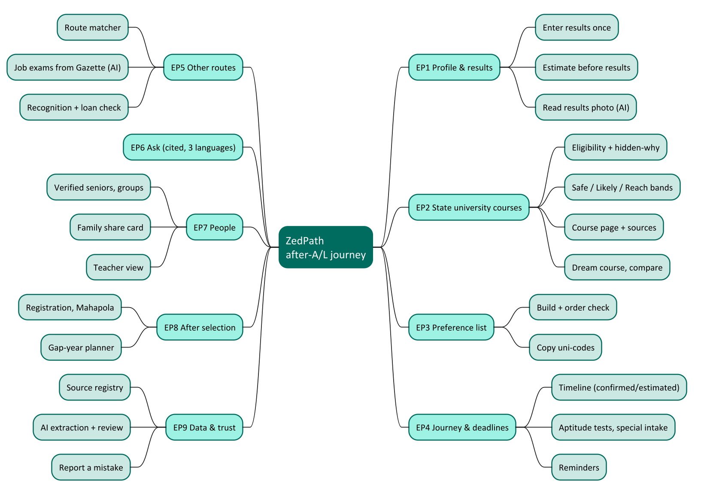

# Introduction

## Purpose

This document is the **product backlog** of ZedPath. It records who the product serves (personas), what they
need to do (user stories), how each need is verified (acceptance criteria), and in which order the needs are
delivered (priority and release). It is the source from which all later requirements, design and test
documents are derived.

## Scope

In scope: every capability of ZedPath for its six personas across nine epics, from entering A/L results
to registering at a university or taking another route. Out of scope: the internal design of those
capabilities (see ZP-DOC-05 and ZP-DOC-06) and the detailed system requirements (see ZP-DOC-03).

## Intended audience

Table: Intended readers and what they use this document for

| Reader | Uses this document to |
|---|---|
| Product owner | Approve scope, priorities and release content |
| Buildathon judges and mentors | Understand what is being built and why, traced to evidence |
| Developers | Know exactly what "done" means for each story |
| Testers | Turn acceptance criteria into acceptance tests (ZP-DOC-08) |

## Relationship to other documents

Table: Position of this document in the ZedPath document set

| Document | Relationship |
|---|---|
| ZP-DOC-01 Vision and Scope | Parent. Defines the problem, goals and boundaries that these stories refine |
| ZP-DOC-03 Software Requirements Specification | Child. Each functional requirement traces back to a story ID defined here |
| ZP-DOC-04 Use Case Model | Child. Use cases group related stories into actor goals |
| ZP-DOC-05 Data Design | Child. Nouns in the stories become entities; acceptance criteria become constraints |
| ZP-DOC-06 Software Architecture | Child. Stories decide which Cloudflare service serves which need |
| ZP-DOC-08 Test Plan | Child. Each acceptance criterion becomes at least one test case |

## Conventions

- **Story format:** **As a** &lt;persona&gt;, **I want** &lt;capability&gt;, **so that** &lt;benefit&gt;.
- **Quality bar:** every story meets INVEST (Independent, Negotiable, Valuable, Estimable, Small, Testable).
- **Acceptance criteria** use *Given / When / Then* and are numbered **AC-nnn.k**, where *nnn* is the story
  number. Each one is independently testable.
- **Priority (MoSCoW):** **Must** (release fails without it), **Should** (important, not vital),
  **Could** (desirable), **Won't** (agreed out of this release).
- **Size:** story points on a Fibonacci scale (1, 2, 3, 5, 8, 13). Points compare stories with each other
  (a 5 is about five times a 1); they are not hours.
- **Release:** **R1** = Gate 3 build (due 11 October 2026); **R2** = after the buildathon.
- **Story IDs** are **US-enn**: *e* is the epic number, *nn* the story within it. IDs are never reused.
- **Change markers** (since v1.0): an item added or changed by a change request carries a marker in italics:
  *New (CR-nnn)*, *Revised (CR-nnn)*, *Superseded by X (CR-nnn)* or *Withdrawn (reason)*. A superseded or withdrawn
  story or criterion keeps its ID and its text for traceability (it is *Deleted* in the sense of ZP-DOC-00), is no
  longer delivered and no longer counts in the totals.
- **Band names** *(VR2)*: this document keeps the band codes Safe, Likely and Reach (SAFE, LIKELY, REACH in data). Since
  14 October 2026 the app shows them to students as **Very likely**, **Possible** and **Unlikely** (AC-203.5).

## Change requests since version 1.0

After v1.0 was approved on 5 October 2026, the product owner approved the change requests below. Their data
design is in ZP-DOC-05 and their delivery is logged in `WORKLOG.md`. "VR" is the product owner's video review of the
live app on 11 October 2026, whose changes were delivered with CR-002 to CR-004.

Table: Change requests and the stories they affect

| CR | Date | Change | Stories |
|---|---|---|---|
| CR-001 | 5 October 2026 | Student accounts: username and password (key derived on the phone), recovery code, profile kept on the account across devices, delete account | US-106, US-107, US-108; AC-101.4 superseded |
| CR-002 | 11 October 2026 | Journey with reminders (phone notifications in the Android app, calendar file elsewhere); Alerts for Gazette and intake notices checked on the phone; Groups per target course and per A/L batch with verified seniors (invite codes), automatic moderation, report, block and rate limits; navigation Paths, My list, Journey, Groups, Ask | US-401 to US-404, US-503, US-702 to US-704, US-706 |
| CR-003 | 11 October 2026 | Account required at the start, with full name, email, Sri Lankan mobile and date of birth, each with its purpose and recorded consent (Personal Data Protection Act, No. 9 of 2022); date of birth moved from Alerts into registration | US-106, US-109; principle 3 |
| CR-004 | 11 October 2026 | Ask ZedPath answer card: verdict, lead and bullets, next-step actions from ZedPath's own data, readable source chips, follow-up questions, Helpful / Report a wrong answer | US-604, US-605, US-606 |
| VR | 11 October 2026 | Sinhala and Tamil interface; search in subjects and courses; Compare redesign; values on the cut-off chart; achievements and interests used in Ask; notification settings; "Sit the A/L again" removed; test-notification button removed; press and hold to select several courses | US-105, US-111, US-204, US-207, US-209, US-305, US-408, US-501, US-507, US-607 |
| CR-005 | 11 October 2026 | Group rules accepted before taking part (server-enforced); no phone numbers or email addresses in messages; popular course groups; labelled sample conversations; WhatsApp-style group screens | US-704, US-706, US-707 |
| CR-006 | 11 October 2026 | Group rules accepted once per account; group info page; preset avatars; rooms stay connected; selection on My list with Compare; Journey steps ticked by the student within their window; follow courses and notices; Journey saved on the account; Alerts moved into the Journey as "Open now" | US-110, US-305, US-401, US-406, US-407, US-409 to US-411, US-503, US-704, US-707, US-708 |

## Change requests since version 2.0

*New in v2.1 (draft).* After v2.0 was approved on 14 October 2026, the product owner made the decisions below. "VR2" is
the product owner's review and decisions of 14 October 2026. The stories added are in Release R2 and were delivered on
15 October 2026; their data design is in ZP-DOC-05 and their tests in ZP-DOC-08.

Table: Change requests since version 2.0 and the stories they affect

| CR | Date | Change | Stories |
|---|---|---|---|
| VR2 | 14 October 2026 | Bands shown as Very likely, Possible and Unlikely (codes unchanged) with a one-line meaning under the tabs; intro guide of seven slides; preset avatars redrawn as plain silhouettes in 12 colours (same codes a01 to a12); an expired session returns to *Log in* | US-203, US-106 |
| CR-007 | 15 October 2026 | *Try the demo* on the Welcome screen: a private throwaway account with the sample student, deleted 24 hours later; demo accounts read groups but cannot create groups, post or report | US-112 |
| CR-008 | 15 October 2026 | University facts on the course page from the UGC report *Sri Lanka University Statistics 2024*, each citing table and page | US-210 |
| CR-009 | 15 October 2026 | Aptitude tests on the course page for the 24 offerings that need one; the NVQ 5/6 to NVQ 7 ladder on the University of Vocational Technology route (R042) | US-211, US-508 |
| CR-010 | 15 October 2026 | Security hardening from audit run-1 and the test campaign: open group chats closed when a session ends or the member leaves; account deletion purges every group the account ever opened; Ask links only fill the box; no demo password; demo flag cleared with the phone; local data tagged with its owner and cleared when another student logs in; a failed log-out is reported; disguised contact details and chat-invite links refused; reports from accounts under a day old or demo accounts do not count toward hiding; post attempts, open connections, account writes, demo accounts, answer feedback and Ask questions capped; cross-site, "null" and malformed Origins refused | US-908, US-102, US-106, US-108, US-112, US-601, US-706, US-907 |

## Sources of evidence

Stories are grounded in the Gate 1 research, not invented. The codes below are cited on every story.

Table: Evidence sources and what each one showed

| Code | Evidence | What it told us |
|---|---|---|
| E1 | Current A/L student, Commerce, Colombo | Doesn't know the Z-score needed or how applying works |
| E2 | Private-university undergraduate, Gampaha | "No proper place to get the information"; applied only to nearby universities |
| E3 | Alternate path, Biological Science | Didn't know the Gazette job-exam route existed |
| E4 | Private-university undergraduate, Matara | Preference-list mistake: "I missed one course... life altering" |
| E5 | Foreign scholarship holder, Kurunegala | Found the route by luck; asked for "all the options... and the steps" |
| E6 | State-university undergraduate, IT | Wanted to see the curriculum; warned that seniors must be verified |
| T1 | Tool test, 27 September 2026 | findmydegree, Unicompass, induwara and ThuSh LK check no grade rules, order or deadlines |
| S | Concept preview (33 screens) | The intended experience, screen by screen |
| Deck S7 | Gate 1 deck, Section 7 | How the product keeps AI-extracted facts honest |
| CR-001 to CR-006 | Change requests approved by the product owner, 5 and 11 October 2026 | Accounts, Journey, Alerts, Groups, contact details, the Ask answer card and group rules (see the table above) |
| VR | Product owner's video review of the live app, 11 October 2026 | Language, search, Compare, chart values, Ask context, reminders, removal of the resit path, selecting several courses |
| VR2, CR-007 to CR-010 | Product owner's decisions of 14 and 15 October 2026 | Band names, demo, university facts, aptitude tests, NVQ ladder, security hardening (see the table above) |

## Product principles

Every story must respect these principles. ZP-DOC-03 restates them as testable non-functional requirements.

1. **Every fact has a source.** Every cut-off, rule, date and fee links to the official page it came from.
2. **Honest about uncertainty.** The app never says "you will get in". Dates are *confirmed* or *estimated*.
3. **Only what is needed, with consent.** *Revised (CR-003); it replaces "No account needed to explore".* An account
   is required. Each personal detail asked for states its purpose, consent is recorded, other students never see the
   details, and everything is deleted with the account.
4. **No paid placement.** No institution can pay to rank higher or look more recognised.
5. **Three languages.** Sinhala, Tamil and English throughout.
6. **Works on a low-cost phone on mobile data.**
7. **Runs within the Cloudflare free plan.** Any story that would need a paid service is redesigned or deferred.

# Personas

## P1 Kavindu: the student who just got results (primary persona)

| | |
|---|---|
| Profile | Physical Science stream, Kurunegala district, Z-score 1.4821. Combined Maths B, Physics C, ICT A |
| Situation | Qualified for university, but Engineering is out of reach. Weighing a state IT course, a private IT degree and the Customs exam at the same time |
| Support | No career counsellor at school. A tuition teacher, two seniors and a Facebook group |
| Family | First in the family to apply to university. Can manage about Rs 1M for a private degree, only with a loan |
| Device | Mid-range Android phone, prepaid mobile data, prefers Sinhala |
| Biggest fear | One mistake (order, deadline, ineligible choice) that costs a year |

## P2 Nimesha: the student who has not sat the exam yet

Commerce stream, sitting the A/L next year (like E1). Wants to know what Z-score her target course has
needed, and what other routes exist (CIMA, CA), before results day.

## P3 Mr. Bandara: the parent

Kavindu's father. Not comfortable in English, uses WhatsApp daily. Wants a clear summary of the options and
their cost, in Sinhala, not an app to learn.

## P4 Ms. Perera: the teacher or counsellor

Teaches Grade 13 Combined Maths to 38 students. Wants to see who is at risk (no Safe choice, no list started)
before the UGC deadline, without collecting every student's data by hand.

## P5 Sahan: the verified senior

Third-year Computer Science student at Ruhuna. Happy to answer questions about his course, but only in a space
where people know he is a real student (E6's warning).

## P6 The curator: the ZedPath data reviewer

Initially the product owner. Loads official documents, reviews AI-extracted facts the system is unsure about,
and fixes reported mistakes. Every published fact passes through this role or an automated two-model check.

## System actors

Table: System actors (non-human)

| Actor | Role |
|---|---|
| Scheduler | Runs the weekly Gazette scan and the daily reminder job |
| AI extractor | Reads handbooks, Gazettes and results photos; proposes structured facts with a confidence score and source page |
| AI checker | A second, independent model that agrees or disagrees with each extracted fact |

# Story map

The story map shows the nine epics along the student's journey. EP1 to EP6 form the core of the product,
EP7 and EP8 deepen it, and EP9 makes every fact trustworthy. The diagram shows the v1.0 baseline; the stories added by
CR-001 to CR-010 sit inside the same nine epics (accounts and the demo in EP1, university facts and aptitude tests in EP2,
Journey in EP4, the NVQ ladder in EP5, Ask in EP6, groups in EP7, session safety in EP9).

Table: Epic summary (verified by script against the stories in this document; superseded and withdrawn stories excluded)

| Epic | Name | Stories | Points | Must | Primary persona |
|---|---|---|---|---|---|
| EP1 | Profile and results | 12 | 30 | 6 | P1, P2 |
| EP2 | State university course discovery | 11 | 36 | 4 | P1 |
| EP3 | Preference list | 5 | 15 | 3 | P1 |
| EP4 | Journey and deadlines | 10 | 28 | 5 | P1 |
| EP5 | Other routes | 7 | 25 | 3 | P1, P2 |
| EP6 | Ask, with sources | 7 | 23 | 2 | P1, P2 |
| EP7 | People around the student | 8 | 31 | 3 | P1, P3, P4, P5 |
| EP8 | After selection | 4 | 10 | 0 | P1 |
| EP9 | Data and trust | 8 | 33 | 5 | P6, P1 |
| | **Total** | **72** | **231** | **31** | |

The backlog holds 74 story IDs: the 72 above, plus US-406 (superseded) and US-507 (withdrawn). At v2.0 it held 67
stories, 220 points and 31 Must stories; at v1.0, 50 stories, 176 points and 24 Must stories.

# Epic EP1: Profile and results

| | |
|---|---|
| Goal | The student enters their situation once, in under a minute, and every screen uses it. |
| Evidence | E1, E5 ("Show all the options he can take after the Z-score is released"), S: Start screen. |

## US-101 Enter my results once

| Priority | Size | Release | Epic | Persona | Evidence |
|---|---|---|---|---|---|
| Must | 3 pts | R1 | EP1 | P1 | E1, E5, S |

> **As a** student who just got results, **I want** to enter my stream, district, Z-score and subject grades once,
**so that** every course and route I see is checked against my own results.

**Acceptance criteria**

- **AC-101.1** **Given** I open ZedPath for the first time, **when** I choose a stream, district, Z-score and three subject grades and tap *Show my options*, **then** I see my results screen within 2 seconds on a 3G connection.
- **AC-101.2** **Given** I enter a Z-score outside the valid range (−4.0000 to +4.0000) or with more than 4 decimals, **then** I see an inline error and cannot continue.
- **AC-101.3** **Given** my subjects do not form a valid combination for the chosen stream, **then** I am told which subject does not fit.
- **AC-101.4** *Superseded by AC-101.5 and AC-106.3 (CR-001, CR-003).* **Given** I have entered my profile, **when** I close and reopen the app on the same device, **then** my profile is still there, and nothing was sent to the server for storage.
- **AC-101.5** *New (CR-003).* **Given** I have entered my profile, **when** I close and reopen the app on the same device, **then** my profile is still there, and it is the same profile that is kept on my account (AC-106.3).

## US-102 Change my profile at any time

| Priority | Size | Release | Epic | Persona | Evidence |
|---|---|---|---|---|---|
| Must | 1 pt | R1 | EP1 | P1 | E1, E5, S |

> **As a** student, **I want** to edit or clear my profile, **so that** I can correct a mistake or try "what if" scenarios.

**Acceptance criteria**

- **AC-102.1** **Given** a saved profile, **when** I change any field, **then** all results recalculate immediately.
- **AC-102.2** **Given** a saved profile, **when** I tap *Clear my data*, **then** the profile is removed from the device and I return to the start screen.
- **AC-102.3** *New (CR-010).* **Given** demo mode was switched on on this phone, **when** I tap *Delete everything on this phone* or *Log out and clear this phone*, **then** demo mode is switched off too, so the next person sees empty forms.
- **AC-102.4** *New (CR-010).* **Given** my results, list and Journey are kept on this phone, **when** a different student logs in on it, **then** my data is cleared from the phone first (the language choice stays), so they never see or inherit it.

## US-103 Estimate my Z-score before results

| Priority | Size | Release | Epic | Persona | Evidence |
|---|---|---|---|---|---|
| Should | 5 pts | R1 | EP1 | P2 | E1 |

> **As a** student who hasn't got results yet (P2), **I want** to enter the marks I expect and see an estimated
Z-score **range**, **so that** I can plan before results day.

**Acceptance criteria**

- **AC-103.1** **Given** I enter expected marks for my three subjects, **then** I see a range (e.g. 1.35 to 1.55), never a single number, labelled *Estimate*.
- **AC-103.2** **Given** an estimate is shown, **then** the screen explains that a Z-score depends on this year's candidates and names the years of data used.
- **AC-103.3** **Given** I use an estimated range, **then** course bands are computed from the *lower* end of the range and marked as based on an estimate.

## US-104 Read my results sheet from a photo

| Priority | Size | Release | Epic | Persona | Evidence |
|---|---|---|---|---|---|
| Should | 3 pts | R1 | EP1 | P1 | E1, E5, S |

> **As a** student, **I want** to photograph my results sheet instead of typing, **so that** I avoid typing mistakes.

**Acceptance criteria**

- **AC-104.1** **Given** I upload a clear photo of an A/L results sheet, **when** extraction completes, **then** the fields are filled in and shown to me to **confirm or correct** before they are used.
- **AC-104.2** **Given** extraction confidence is low for any field, **then** that field is highlighted for me to check.
- **AC-104.3** **Given** a photo was uploaded, **then** it is deleted from storage as soon as extraction finishes (verifiable in logs), and is never used for anything else.

## US-105 Use the app in my language

| Priority | Size | Release | Epic | Persona | Evidence |
|---|---|---|---|---|---|
| Must | 1 pt | R1 | EP1 | P1 | E1, E5, S |

> **As a** student, **I want** to switch between Sinhala, Tamil and English at any time, **so that** I understand every word.

**Acceptance criteria**

- **AC-105.1** **Given** any screen, **when** I switch language, **then** all interface text changes without losing my place.
- **AC-105.2** **Given** a fact whose official source exists only in one language, **then** the original-language source link is still shown.
- **AC-105.3** *New (VR).* **Given** the Sinhala or Tamil interface, **then** course names, university names and official quotations are shown in English, as published.
- **AC-105.4** *New (VR).* **Given** the Sinhala or Tamil interface, **then** the app states that the text is an AI translation that native speakers are still checking, until that review is complete.

## US-106 Create an account and use it on any device

*New (CR-001); required at the start since CR-003.*

| Priority | Size | Release | Epic | Persona | Evidence |
|---|---|---|---|---|---|
| Must | 5 pts | R1 | EP1 | P1, P2 | CR-001, CR-003 |

> **As a** student, **I want** an account with a username and password that keeps my results, achievements and
interests, **so that** I see the same profile on any phone or computer I log in from.

**Acceptance criteria**

- **AC-106.1** **Given** I open ZedPath without being logged in, **when** I try to go past the welcome screen, **then** I am asked to create an account or log in first.
- **AC-106.2** **Given** I create an account, **then** my username must follow BR-050 and my password BR-051, and the password itself never leaves my device: only a key derived from it on the device is sent.
- **AC-106.3** **Given** I am logged in and save my results, achievements or interests, **when** I log in on another device, **then** the same profile is restored there.
- **AC-106.4** **Given** I changed my profile while offline, **when** the device is online again, **then** my change is sent to my account and is not overwritten by the older copy on the server.
- **AC-106.5** *New (VR2).* **Given** my session has expired or was ended on another device, **when** the app next calls the server, **then** I am taken to *Log in*, instead of seeing "Please log in" inside a screen.
- **AC-106.6** *New (CR-010).* **Given** I tap *Log out* or *Log out everywhere*, **when** the request fails (for example, no connection), **then** I am told that I am still logged in and should try again, instead of being shown as logged out.

## US-107 Get back into my account with a recovery code

*New (CR-001).*

| Priority | Size | Release | Epic | Persona | Evidence |
|---|---|---|---|---|---|
| Should | 2 pts | R1 | EP1 | P1 | CR-001 |

> **As a** student who has forgotten my password, **I want** to reset it with a recovery code, **so that** I do not
lose my account (ZedPath cannot send reset emails).

**Acceptance criteria**

- **AC-107.1** **Given** I create an account, **then** I am shown a recovery code once, with a warning that I will not see it again, and I confirm that I have saved it before I continue.
- **AC-107.2** **Given** I enter my username, my recovery code and a new password, **then** my password is changed, a new recovery code is shown, and the old code no longer works.
- **AC-107.3** **Given** I type the digits 0, 1 or 8 where the code has the letters O, I or B, **then** the code is still accepted.

## US-108 Delete my account and everything in it

*New (CR-001).*

| Priority | Size | Release | Epic | Persona | Evidence |
|---|---|---|---|---|---|
| Must | 2 pts | R1 | EP1 | P1 | CR-001 |

> **As a** student, **I want** to delete my account, **so that** ZedPath keeps nothing about me.

**Acceptance criteria**

- **AC-108.1** **Given** I confirm *Delete account*, **then** my account and everything stored under it (contact details, results, achievements, interests, sessions, recovery code, group memberships, reports, blocks and my Journey) are deleted on the server, my data is cleared from this device, and I return to the welcome screen.
- **AC-108.2** **Given** I posted messages in groups, **when** I delete my account, **then** my messages are deleted from every group I was in.
- **AC-108.3** *New (CR-010).* **Given** I opened a group and later left it, **when** I delete my account, **then** my messages are deleted from that group too.

## US-109 Give my contact details with a stated purpose and consent

*New (CR-003).*

| Priority | Size | Release | Epic | Persona | Evidence |
|---|---|---|---|---|---|
| Must | 3 pts | R1 | EP1 | P1, P3 | CR-003 |

> **As a** student creating an account, **I want** to know why each personal detail is asked for and to agree to
it, **so that** I can trust ZedPath with my name, email, mobile number and date of birth.

**Acceptance criteria**

- **AC-109.1** **Given** I create an account, **then** I must give my full name, email address, Sri Lankan mobile number and date of birth, and the screen states what each is used for before I agree.
- **AC-109.2** **Given** I have not ticked the consent statement, which includes that a parent or guardian agrees if I am under 18, **then** the account is not created, and the server refuses it too.
- **AC-109.3** **Given** a value breaks a rule (BR-052 to BR-055), **then** I see which field is wrong, and the server refuses the same value.
- **AC-109.4** **Given** my account was made before CR-003 and has no contact details, **when** I next open ZedPath, **then** I am asked to complete them before anything else.
- **AC-109.5** **Given** I enter an email address or mobile number, **then** the screen tells me that ZedPath does not yet send a code to verify it.
- **AC-109.6** **Given** my details are stored, **then** other students never see them: groups show only my username and avatar.

## US-110 Choose a profile picture

*New (CR-006).*

| Priority | Size | Release | Epic | Persona | Evidence |
|---|---|---|---|---|---|
| Could | 1 pt | R1 | EP1 | P1, P5 | CR-006 |

> **As a** student, **I want** to pick a picture for my account from a set of avatars, **so that** others in groups
recognise me without my photograph.

**Acceptance criteria**

- **AC-110.1** **Given** I open *Me*, **then** I can choose one of 12 preset avatars, or keep my initials, which is the default.
- **AC-110.2** **Given** I have chosen an avatar, **then** it is shown in the app bar, in group member lists and next to the group messages I post, on every device I log in from.
- **AC-110.3** **Given** any device, **then** there is no way to upload a photograph, and the server accepts only the preset avatars or none.

## US-111 Find my subjects by searching

*New (VR).*

| Priority | Size | Release | Epic | Persona | Evidence |
|---|---|---|---|---|---|
| Should | 1 pt | R1 | EP1 | P1, P2 | VR |

> **As a** student entering my results, **I want** to search the subject list, **so that** I find my subjects quickly.

**Acceptance criteria**

- **AC-111.1** **Given** *About you*, **when** I type the start of each word of a subject name, or a common short form (for example "comb math" or "ict"), **then** only matching subjects are listed, ignoring case and punctuation.

## US-112 Try ZedPath with a sample student

*New (CR-007); hardened by CR-010.*

| Priority | Size | Release | Epic | Persona | Evidence |
|---|---|---|---|---|---|
| Should | 3 pts | R2 (delivered 15 Oct 2026) | EP1 | P1, P2 | CR-007, CR-010 |

> **As a** student who wants to see ZedPath before giving my details, **I want** to try it with a sample student in one
tap, **so that** I can judge whether it helps me before I create an account.

**Acceptance criteria**

- **AC-112.1** **Given** the Welcome screen, **when** I tap *Try the demo*, **then** a demo account holding the sample student (results, achievements, interests and sample contact details) is created and I am logged in, without a username, a password or any detail of mine.
- **AC-112.2** **Given** two visitors try the demo, **then** each gets a private copy, and nothing one of them does is visible to the other.
- **AC-112.3** **Given** a demo account, **then** nobody can log in to it with a password, and *Me* says that it is a demo whose groups are read-only and that it is deleted 24 hours after it was opened.
- **AC-112.4** **Given** a demo account more than 24 hours old, **when** anyone next taps *Try the demo*, **then** it and every row stored under it are deleted, and no real account is touched.
- **AC-112.5** **Given** a demo account in *Groups*, **then** it can join a group that already exists and read it, but it cannot create a group, post a message or report one, and the server refuses each attempt.
- **AC-112.6** *(CR-010)* **Given** demo mode or the demo account, **then** no password is prefilled on any screen or shipped in the app.
- **AC-112.7** *(CR-010)* **Given** 500 demo accounts already exist, **when** someone taps *Try the demo*, **then** they are told the demo is busy and invited to create an account; each tap deletes at most 50 expired demo accounts, and a failed clean-up never blocks the demo.

# Epic EP2: State university course discovery

| | |
|---|---|
| Goal | Show every state-university course the student can actually reach, how likely it is, and why. |
| Evidence | E2, E4, T1 (no tool checks grade rules), S: Results, Course page, Subject check, Dream course, Compare. |

## US-201 See every course I am eligible for

| Priority | Size | Release | Epic | Persona | Evidence |
|---|---|---|---|---|---|
| Must | 5 pts | R1 | EP2 | P1 | E1, E2, T1 |

> **As a** student, **I want** to see all state-university courses my stream and subject grades make me eligible for,
**so that** I don't miss any (E2 applied only to nearby universities).

**Acceptance criteria**

- **AC-201.1** **Given** my profile, **then** I see the count and list of eligible course offerings (course × university).
- **AC-201.2** **Given** a course requires a subject I didn't take or a grade I didn't reach, **then** it is **not** in the eligible list.
- **AC-201.3** **Given** the handbook rule for a course is "C in Combined Maths **or** Physics", **when** I have a C in Physics only, **then** the course **is** eligible (the alternative is evaluated correctly).

## US-202 See why a course is hidden from me

| Priority | Size | Release | Epic | Persona | Evidence |
|---|---|---|---|---|---|
| Must | 2 pts | R1 | EP2 | P1 | T1 |

> **As a** student, **I want** to see which courses were hidden and the exact rule I failed, **so that** I trust the list.

**Acceptance criteria**

- **AC-202.1** **Given** some courses were excluded, **then** I see "N courses hidden", and each has a plain-language reason and a link to its handbook section.

## US-203 See Safe / Likely / Reach for each course

*Revised (VR2): shown to students as "See how likely each course is: Very likely, Possible or Unlikely" (AC-203.5).*

| Priority | Size | Release | Epic | Persona | Evidence |
|---|---|---|---|---|---|
| Must | 5 pts | R1 | EP2 | P1 | E1 |

> **As a** student, **I want** each eligible course banded Safe, Likely or Reach from several years of my district's
cut-offs, **so that** I understand my real chances rather than a yes/no from one year.

**Acceptance criteria**

- **AC-203.1** **Given** at least 3 years of district cut-offs for an offering, **then** the band is computed from where my Z-score sits within the historical range (see ZP-DOC-03 for the exact rule).
- **AC-203.2** **Given** fewer than 3 years of data, **then** the course is marked *Not enough history* rather than banded.
- **AC-203.3** **Given** any band is shown, **then** the gap to last year's cut-off is shown with its sign (e.g. +0.061) and the trend (rising, steady, jumpy).
- **AC-203.4** **Given** any band, **then** the wording never promises admission.
- **AC-203.5** *New (VR2).* **Given** any screen that names a band, **then** Safe, Likely and Reach are shown as *Very likely*, *Possible* and *Unlikely* in every interface language, each band tab on *Courses* has a one-line meaning under it (for example "Above the latest cut-off, but not above every recent year"), and the band codes stored and sent by the server (SAFE, LIKELY, REACH) do not change.

## US-204 Open a course page with sources

| Priority | Size | Release | Epic | Persona | Evidence |
|---|---|---|---|---|---|
| Must | 3 pts | R1 | EP2 | P1 | E6 |

> **As a** student, **I want** one page per course offering with its district cut-off history, duration, medium,
aptitude-test flag and what the first year teaches, **so that** I can decide with everything in one place (E6).

**Acceptance criteria**

- **AC-204.1** **Given** I open an offering, **then** I see a table of cut-offs by year for my district, with my Z-score in the last row.
- **AC-204.2** **Given** any number on the page, **then** it links to the source document and page it came from, with the date it was verified.
- **AC-204.3** *New (VR).* **Given** the cut-off chart on a course page, **then** each point shows its cut-off value printed beside it, so it can be read without tapping.

## US-205 Filter and sort courses

| Priority | Size | Release | Epic | Persona | Evidence |
|---|---|---|---|---|---|
| Should | 3 pts | R1 | EP2 | P1 | E2 |

> **As a** student, **I want** to filter by band, university, field and distance from home, **so that** a long list stays usable.

**Acceptance criteria**

- **AC-205.1** **Given** the results list, **when** I filter by band *Likely*, **then** only Likely offerings are shown and the count updates.

## US-206 Work backwards from a dream course

| Priority | Size | Release | Epic | Persona | Evidence |
|---|---|---|---|---|---|
| Should | 3 pts | R1 | EP2 | P1 | E2, E4, T1, S |

> **As a** student, **I want** to pick the course I really want and see how far away it is and the nearest open
alternatives, **so that** I can decide whether to aim higher or move on.

**Acceptance criteria**

- **AC-206.1** **Given** I choose a dream offering above my reach, **then** I see the gap to its lowest cut-off in the last 5 years and whether that gap is "small" or "large" (thresholds defined in ZP-DOC-03).
- **AC-206.2** **Then** I see up to 3 closest offerings in the same field that are Safe or Likely for me.

## US-207 Compare up to three courses

*Revised (VR): v1.0 title "Compare two courses"; Compare now takes up to three courses.*

| Priority | Size | Release | Epic | Persona | Evidence |
|---|---|---|---|---|---|
| Could | 3 pts | R1 | EP2 | P1 | E2, E4, T1, S, VR |

> **As a** student, **I want** up to three offerings side by side, **so that** I can choose between them.

**Acceptance criteria**

- **AC-207.1** **Given** I select two offerings, **then** I see band, length, medium, campus, extra steps (aptitude test) and trend in two columns.
- **AC-207.2** *New (VR).* **Given** I compare up to three offerings, **then** each is a column, and on a narrow screen the columns swipe sideways one at a time.
- **AC-207.3** *New (VR).* **Given** fewer than three offerings are compared, **then** a "+" column on the right opens a picker where I search my Safe, Likely and Reach courses or choose from My list.
- **AC-207.4** *New (VR).* **Given** any *Compare* button anywhere in the app, **when** I tap it, **then** the Compare screen opens with that course included.

## US-208 See what living there costs

| Priority | Size | Release | Epic | Persona | Evidence |
|---|---|---|---|---|---|
| Could | 5 pts | R2 | EP2 | P1, P3 | E2, E4, T1, S |

> **As a** student from a low-income family, **I want** the monthly living cost by campus, **so that** I can compare the real cost of each choice.

**Acceptance criteria**

- **AC-208.1** **Given** an offering, **then** I see board, food and travel estimates with the number of reports behind them and the date collected.

## US-209 Find a course by searching

*New (VR).*

| Priority | Size | Release | Epic | Persona | Evidence |
|---|---|---|---|---|---|
| Should | 2 pts | R1 | EP2 | P1 | E2, VR |

> **As a** student, **I want** to search all my courses by name, university or Uni-Code, **so that** I find a course
without scrolling through every band.

**Acceptance criteria**

- **AC-209.1** **Given** *Courses*, **when** I type the start of words of a course or university name (for example "ruh comp"), a common short form, or a Uni-Code (for example "012F"), **then** matching courses from every band are listed, ignoring case and punctuation.

## US-210 See official facts about the university

*New (CR-008).*

| Priority | Size | Release | Epic | Persona | Evidence |
|---|---|---|---|---|---|
| Could | 3 pts | R2 (delivered 15 Oct 2026) | EP2 | P1, P3 | E2, CR-008 |

> **As a** student choosing between universities, **I want** official facts about the university on each course page,
**so that** I compare campuses with numbers instead of hearsay (E2: "no proper place to get the information").

**Acceptance criteria**

- **AC-210.1** **Given** a course page, **then** a *University facts* card shows, for the course's university or institute, the students admitted for 2023/24, the undergraduates in 2024, the permanent hostel places and the share of undergraduates they can house, the Mahapola and Bursary recipients, and the graduates of 2024, wherever the UGC report gives them.
- **AC-210.2** **Given** any fact on the card, **then** it names its table and page in the UGC report *Sri Lanka University Statistics 2024* and links to that page of the official PDF on the UGC website.
- **AC-210.3** **Given** the report's own caveats, **then** they are shown with the number: 2024 figures are provisional; a count is lower where faculties did not submit figures; university totals include their campuses; and where the report says "Information not submitted", no number is shown, never a zero.

## US-211 See a course's aptitude test on its page

*New (CR-009).*

| Priority | Size | Release | Epic | Persona | Evidence |
|---|---|---|---|---|---|
| Should | 2 pts | R2 (delivered 15 Oct 2026) | EP2 | P1 | T1, S, CR-009 |

> **As a** student looking at a course that needs an aptitude or practical test, **I want** its page to show the
official notice and dates of that test, **so that** I do not lose the course by missing the test (screen S: "I missed
the architecture aptitude test").

**Acceptance criteria**

- **AC-211.1** **Given** one of the 24 offerings that need an aptitude or practical test (BR-025), **then** its course page shows an *Aptitude test* card with the university that runs the test, the application and test dates from its official notice, and a link to that notice.
- **AC-211.2** **Given** the dates on the card are the last intake's and have passed (Sri Lanka date), **then** they are labelled as the last intake's and in the past, with a note that the university announces the next dates; no date for the next intake is estimated.
- **AC-211.3** **Given** a course whose test is one joint practical test held at other universities, **then** the card says so and links to the official notices of the universities that hold it.
- **AC-211.4** **Given** a course without a test, **then** no aptitude card is shown; **and given** any card, every link is an official https page of the university.

# Epic EP3: Preference list

| | |
|---|---|
| Goal | Prevent the single most expensive mistake: a badly ordered UGC preference list. |
| Evidence | E4 ("I missed one course... life altering"), T1 (no tool checks order), S: Preference list, UGC form. |

## US-301 Build my preference list

| Priority | Size | Release | Epic | Persona | Evidence |
|---|---|---|---|---|---|
| Must | 3 pts | R1 | EP3 | P1 | E4 |

> **As a** student, **I want** to add eligible offerings to a list and arrange them in the order I want them, **so that** I can prepare my UGC application.

**Acceptance criteria**

- **AC-301.1** **Given** an eligible offering, **when** I tap *Add to my list*, **then** it appears at the bottom of my list with its band and uni-code.
- **AC-301.2** **Given** my list, **when** I drag an item, **then** the order changes and is saved on my device.
- **AC-301.3** **Given** an offering I'm not eligible for, **then** it cannot be added.

## US-302 Get warned about a bad order

| Priority | Size | Release | Epic | Persona | Evidence |
|---|---|---|---|---|---|
| Must | 5 pts | R1 | EP3 | P1 | E4, T1 |

> **As a** student, **I want** to be warned when a Safe choice sits above a course I want more, **so that** I am not placed in it and locked out of my preferred course.

**Acceptance criteria**

- **AC-302.1** **Given** a Safe offering ranked above a Likely or Reach offering, **then** a warning explains, in plain words, that I'd be placed in the Safe one if I qualify for both.
- **AC-302.2** **Given** my list has no Safe choice at all, **then** I am warned that I may not be placed anywhere.
- **AC-302.3** **Given** I tap *Fix order for me*, **then** a suggested order is shown that keeps my most-wanted choices first and Safe choices last, and I must confirm it.

## US-303 Copy uni-codes in order

| Priority | Size | Release | Epic | Persona | Evidence |
|---|---|---|---|---|---|
| Must | 1 pt | R1 | EP3 | P1 | E4 |

> **As a** student, **I want** to copy my uni-codes in the right order, **so that** I can enter them into the UGC online form without mistakes.

**Acceptance criteria**

- **AC-303.1** **Given** my list, **when** I tap *Copy uni-codes*, **then** the clipboard contains the codes in list order, one per line.

## US-304 Learn the UGC form step by step

| Priority | Size | Release | Epic | Persona | Evidence |
|---|---|---|---|---|---|
| Should | 3 pts | R1 | EP3 | P1 | E4 |

> **As a** first-generation applicant, **I want** the official application explained step by step with common mistakes, **so that** my application isn't sent back.

**Acceptance criteria**

- **AC-304.1** **Given** I open the guide, **then** I see each step of the official process with the most common mistake for that step, linked to the official instructions.

## US-305 Select several courses at once

*New (VR on Courses; extended to My list with Compare by CR-006).*

| Priority | Size | Release | Epic | Persona | Evidence |
|---|---|---|---|---|---|
| Could | 3 pts | R1 | EP3 | P1 | VR, CR-006 |

> **As a** student, **I want** to select several courses at once, **so that** I can add them to my list or compare
them in one step instead of one by one.

**Acceptance criteria**

- **AC-305.1** **Given** a course in *Courses* or in *My list*, **when** I press and hold it (or tap *Select*), **then** selection starts with that course ticked, and each further tap ticks or unticks a course instead of opening it.
- **AC-305.2** **Given** courses selected in *Courses*, **when** I tap *Add to my list* on the selection bar, **then** every selected course is added under the same rules as adding one (AC-301.3, at most 125, no duplicates), and I am told how many were added, how many were already on my list, and whether the list was full.
- **AC-305.3** **Given** courses selected in *Courses* or *My list*, **when** I tap *Compare* on the selection bar, **then** Compare opens with the selected courses in the order I selected them, at most three.

# Epic EP4: Journey and deadlines

| | |
|---|---|
| Goal | The student never misses a date, including the ones nobody tells them about. |
| Evidence | E1, E3, S: Journey, Aptitude tests, Special intake, Timeline. |

## US-401 See my journey with the next step first

*Revised (CR-002, CR-006): the student, not the date, marks a step done (US-407).*

| Priority | Size | Release | Epic | Persona | Evidence |
|---|---|---|---|---|---|
| Must | 3 pts | R1 | EP4 | P1 | E5, CR-002, CR-006 |

> **As a** student, **I want** one screen showing every stage from results to registration, with the next action on top, **so that** I always know what to do now.

**Acceptance criteria**

- **AC-401.1** *Superseded by AC-401.2 and US-407 (CR-006).* **Given** today's date and my profile, **then** stages before today are marked done, and the next open deadline is shown at the top with days remaining.
- **AC-401.2** *New (CR-006).* **Given** my Journey, **then** I see the steps in order (three preparation steps, then the UGC steps), the courses and notices I follow, and the next dated item at the top with the days remaining; no step is shown as done unless I ticked it.

## US-402 Know whether a date is confirmed or estimated

| Priority | Size | Release | Epic | Persona | Evidence |
|---|---|---|---|---|---|
| Must | 2 pts | R1 | EP4 | P1 | T1 |

> **As a** student, **I want** every date marked *confirmed* (with source) or *estimated* (with basis), **so that** I know how much to rely on it.

**Acceptance criteria**

- **AC-402.1** **Given** a deadline from an official notice, **then** it is marked Confirmed and links to the notice.
- **AC-402.2** *Superseded by AC-402.3 (CR-002, CR-006).* **Given** a deadline inferred from previous years, **then** it is marked Estimated and states "based on last year: June".
- **AC-402.3** *New (CR-002, CR-006).* **Given** a UGC step whose date the UGC has not yet announced by press notice, **then** it shows *Not announced yet* with the official rule and its handbook page (for example "within two weeks of the closing date", p.116), and no date is invented.

## US-403 Be told about aptitude tests for courses on my list

| Priority | Size | Release | Epic | Persona | Evidence |
|---|---|---|---|---|---|
| Must | 3 pts | R1 | EP4 | P1 | T1 |

> **As a** student, **I want** to know if any course on my list needs a separate aptitude test, and its application date, **so that** I don't lose the course (screen S: "I missed the architecture aptitude test").

**Acceptance criteria**

- **AC-403.1** **Given** my list includes an offering with an aptitude test, **then** the journey shows a separate step for that test's application and test date.

## US-404 Get reminders before deadlines

*Revised (CR-002): reminders are phone notifications in the Android app and a calendar file elsewhere; web push is
not used.*

| Priority | Size | Release | Epic | Persona | Evidence |
|---|---|---|---|---|---|
| Should | 5 pts | R1 | EP4 | P1 | E1, E3, S, CR-002 |

> **As a** student, **I want** my deadlines in my phone's calendar or as notifications, **so that** I'm reminded 7 days and 1 day before each deadline on my journey.

**Acceptance criteria**

- **AC-404.1** **Given** my journey, **when** I tap *Add to calendar*, **then** I receive a calendar file (.ics) with every deadline and alarms 7 days and 1 day before each.
- **AC-404.2** *Superseded by AC-404.5 (CR-002).* **Given** a browser that supports web push, **when** I turn on notifications, **then** I receive a notification 7 days and 1 day before each deadline on my journey.
- **AC-404.3** *Superseded by AC-404.6 (CR-002).* **Given** I turn notifications off, **then** my push subscription is deleted from the server and no further notifications are sent.
- **AC-404.4** *Superseded by AC-404.6 (CR-002).* **Given** I never turn notifications on, **then** no identifier of mine exists on the server.
- **AC-404.5** *New (CR-002).* **Given** the ZedPath Android app with notifications allowed, **then** the phone shows a notification 7 days and 1 day before each dated item in my Journey, at the time set in my reminder settings (US-408).
- **AC-404.6** *New (CR-002).* **Given** any reminder, **then** it is scheduled on my phone or in my calendar; no push subscription or device identifier is stored on the server for reminders, and turning notifications off on the phone stops them.

> **Note:** Email reminders were dropped in v0.9. The Cloudflare free plan does not allow Workers to send email
> to arbitrary recipients (Cloudflare Email Service pricing, retrieved 5 October 2026). CR-002 replaced web push with
> notifications scheduled by the Android app on the phone; calendar files remain for every other device. Both are
> free. SMS and email reminders wait for a sending domain and an SMS service.

## US-405 Check whether a special intake applies to me

| Priority | Size | Release | Epic | Persona | Evidence |
|---|---|---|---|---|---|
| Could | 2 pts | R2 | EP4 | P1 | E1, E3, S |

> **As a** student with a special circumstance, **I want** to check the special intake categories, **so that** I don't miss a second door.

**Acceptance criteria**

- **AC-405.1** **Given** I answer the category questions, **then** I see which categories may apply, each linked to its handbook section.

## US-406 Add my own steps to the journey

*Superseded by US-409 and US-410 (CR-002, CR-006). Not counted in the totals.*

| Priority | Size | Release | Epic | Persona | Evidence |
|---|---|---|---|---|---|
| Could | 3 pts | R2 | EP4 | P1 | E1, E3, S |

> **As a** student, **I want** to add a route's dates (e.g. a job exam) to my journey, **so that** everything is on one timeline.

**Acceptance criteria:** none; the need is met by following courses (US-409) and notices or other paths (US-410).

## US-407 Tick my own Journey steps when they open

*New (CR-006).*

| Priority | Size | Release | Epic | Persona | Evidence |
|---|---|---|---|---|---|
| Must | 3 pts | R1 | EP4 | P1 | E5, CR-006 |

> **As a** student, **I want** to tick each Journey step myself when I have done it, **so that** my Journey shows
what I have really done, not what the calendar assumes.

**Acceptance criteria**

- **AC-407.1** **Given** a new account, **then** every Journey step starts unticked.
- **AC-407.2** **Given** one of the three preparation steps (enter my results, build my list, compare courses), **then** I can tick or untick it at any time.
- **AC-407.3** **Given** a UGC step, **when** the opening date in the UGC press notice has arrived (Sri Lanka date), **then** I can tick or untick it.
- **AC-407.4** **Given** a UGC step whose date is not announced or not yet reached, **then** its tick box is disabled with the reason, and if a request to tick it reaches the server anyway, the server refuses it and stores nothing.

## US-408 Choose how I am reminded

*New (VR).*

| Priority | Size | Release | Epic | Persona | Evidence |
|---|---|---|---|---|---|
| Should | 2 pts | R1 | EP4 | P1 | E1, VR |

> **As a** student, **I want** to choose which reminders I get and at what time, **so that** they arrive when they
are useful to me.

**Acceptance criteria**

- **AC-408.1** **Given** *Me*, **then** I can turn the 7-day reminder and the 1-day reminder on or off, choose 8 am or 6 pm, and turn the new-alert count on or off.
- **AC-408.2** **Given** I have never changed these settings, **then** both reminders are on at 8 am and the count is shown, exactly as before the settings existed.
- **AC-408.3** **Given** I change a setting, **then** it applies to the phone notifications and to the next calendar file I download, and it is kept on this phone.
- **AC-408.4** **Given** *Me*, **then** there is no test-notification button (removed after the video review).

## US-409 Follow a course into my Journey

*New (CR-006); with US-410 it supersedes US-406.*

| Priority | Size | Release | Epic | Persona | Evidence |
|---|---|---|---|---|---|
| Should | 2 pts | R1 | EP4 | P1 | E1, CR-006 |

> **As a** student, **I want** to follow a course from its course page, **so that** it stays in my Journey while I
decide.

**Acceptance criteria**

- **AC-409.1** **Given** a course page, **when** I tap *Follow*, **then** the course appears in my Journey, and I can unfollow it again.
- **AC-409.2** **Given** a request to follow something that is not a 2025/26 course offering, **then** the server refuses it.

## US-410 Follow a notice or other path and record that I applied

*New (CR-006); with US-409 it supersedes US-406.*

| Priority | Size | Release | Epic | Persona | Evidence |
|---|---|---|---|---|---|
| Should | 3 pts | R1 | EP4 | P1 | E3, E5, CR-006 |

> **As a** student, **I want** to follow a Gazette exam, an intake or another path and tick *I applied*, **so that**
every application I am making is on one timeline.

**Acceptance criteria**

- **AC-410.1** **Given** a notice under *Open now* or an other-path page, **when** I tap *Follow*, **then** it appears in my Journey with its closing date and source, and I can unfollow it again.
- **AC-410.2** **Given** a followed notice whose application period has opened (or which has no opening date), **then** I can tick or untick *I applied*.
- **AC-410.3** **Given** a followed notice that has not opened yet, **then** *I applied* cannot be ticked, and the server refuses the tick if it is sent anyway.
- **AC-410.4** **Given** a request to follow an identifier that is not in ZedPath's route catalogue, **then** the server refuses it.

## US-411 Keep my Journey on my account

*New (CR-006).*

| Priority | Size | Release | Epic | Persona | Evidence |
|---|---|---|---|---|---|
| Must | 3 pts | R1 | EP4 | P1 | CR-001, CR-006 |

> **As a** student, **I want** my followed courses, followed notices and ticked steps saved on my account, **so that**
my Journey is the same on every device and I never lose my progress.

**Acceptance criteria**

- **AC-411.1** **Given** I follow, tick or untick anything in my Journey, **when** I log in on another device, **then** the same Journey is shown there.
- **AC-411.2** **Given** I delete my account, **then** my Journey is deleted with it (AC-108.1).
- **AC-411.3** **Given** a request about the Journey without a valid session, **then** the server refuses it, and one account can never read or change another account's Journey.

# Epic EP5: Other routes

| | |
|---|---|
| Goal | Make every path visible, not just the state university. |
| Evidence | E1 (CIMA), E3 (Gazette, regret), E5 (luck), deck: 42,937 places for 176,527 qualified. |

## US-501 See every route my results open

| Priority | Size | Release | Epic | Persona | Evidence |
|---|---|---|---|---|---|
| Must | 5 pts | R1 | EP5 | P1 | E1, E3, E5 |

> **As a** student, **I want** to see all non-UGC routes my results qualify me for, grouped by type, **so that** I have a real Plan B.

**Acceptance criteria**

- **AC-501.1** *Superseded by AC-501.3 (VR: the "Sit the A/L again" path was removed).* **Given** my profile, **then** I see routes in groups: private and non-state degrees, higher national diplomas, professional qualifications, vocational courses, job exams, study abroad and a retry.
- **AC-501.3** *New (VR).* **Given** my profile, **then** I see routes in six groups: private and non-state degrees, higher national diplomas, professional qualifications, vocational courses, job exams and study abroad; there is no "Sit the A/L again" path.
- **AC-501.2** **Given** a route requires something I don't meet (e.g. Biology stream for nursing), **then** it is shown as *Not open to you* with the reason.

## US-502 Open a route's details

| Priority | Size | Release | Epic | Persona | Evidence |
|---|---|---|---|---|---|
| Must | 3 pts | R1 | EP5 | P1 | E1, E3, E5 |

> **As a** student, **I want** the entry requirements, duration, rough cost, intake timing and source for each route, **so that** I can compare it with a state course.

**Acceptance criteria**

- **AC-502.1** **Given** a route, **then** every requirement, fee and date has a source link and a verified date.

## US-503 Be alerted about job exams I qualify for

*Revised (CR-002: intake notices too, checked on the phone; CR-003: date of birth from registration; CR-006: Alerts
become the Journey's "Open now" tab).*

| Priority | Size | Release | Epic | Persona | Evidence |
|---|---|---|---|---|---|
| Must | 5 pts | R1 | EP5 | P1 | E3, CR-002, CR-003, CR-006 |

> **As a** student (E3), **I want** to be told when a government exam I qualify for is announced in the Gazette, **so that** I don't find out too late.

**Acceptance criteria**

- **AC-503.1** **Given** a new Gazette notice is processed, **when** it announces an exam whose education and age rules I meet, **then** it appears in my Alerts with the closing date and a link to the notice.
- **AC-503.2** **Given** the notice's details were extracted with low confidence, **then** it is not shown until a curator has reviewed it.
- **AC-503.3** *New (CR-002, CR-003).* **Given** a Gazette job-exam or intake notice with a closing date, **then** it shows whether I meet its A/L-pass rule and its age rule, checked on my phone against my results and the date of birth I gave at registration, and marks a rule *unknown* when the data is missing; O/L rules are shown for me to check, not evaluated.
- **AC-503.4** *New (CR-002).* **Given** the list of notices, **then** open and upcoming notices come first, soonest closing date first, and closed ones last.
- **AC-503.5** *New (CR-006).* **Given** the Journey, **then** open notices are in its second tab, *Open now*; there is no bell in the top bar, and the number of new notices shows on the Journey tab when the new-alert count is on (US-408).

## US-504 Check whether a degree is recognised

| Priority | Size | Release | Epic | Persona | Evidence |
|---|---|---|---|---|---|
| Should | 5 pts | R2 | EP5 | P1, P3 | E1, E3, E5 |

> **As a** family about to pay for a private degree, **I want** to check whether the awarding university and the local programme are recognised, **so that** we don't lose years and money.

**Acceptance criteria**

- **AC-504.1** **Given** a programme, **then** I see the status of each check (awarding university listed, local programme approved, loan-scheme eligible), each with its source and date checked.

## US-505 Check the interest-free loan scheme

| Priority | Size | Release | Epic | Persona | Evidence |
|---|---|---|---|---|---|
| Should | 3 pts | R2 | EP5 | P1 | E1, E3, E5 |

> **As a** student, **I want** to check if I meet the basic conditions of the government interest-free loan for approved non-state degrees, **so that** I know if a private degree is affordable.

**Acceptance criteria:** to be detailed when the story is scheduled (R2 backlog refinement).

## US-506 See scholarships abroad

| Priority | Size | Release | Epic | Persona | Evidence |
|---|---|---|---|---|---|
| Could | 3 pts | R2 | EP5 | P1 | E5 |

> **As a** student (E5), **I want** the government scholarships open to school leavers, with usual timing and what they ask for, **so that** finding one isn't luck.

**Acceptance criteria:** to be detailed when the story is scheduled (R2 backlog refinement).

## US-507 Understand what retrying would take

*Withdrawn (VR, 11 October 2026: the product owner removed the "Sit the A/L again" path from the app). Not counted
in the totals. The gap to a dream course remains in US-206.*

| Priority | Size | Release | Epic | Persona | Evidence |
|---|---|---|---|---|---|
| Should | 2 pts | R1 | EP5 | P1 | E1, E3, E5 |

> **As a** student who missed a dream course, **I want** an honest view of the gap, the attempt count and the alternatives, **so that** I decide with real numbers.

**Acceptance criteria**

- **AC-507.1** **Given** a dream offering, **then** I see the Z-score gap, my attempt number out of three, and the routes I could take while preparing.

## US-508 See how a vocational qualification leads to a degree

*New (CR-009).*

| Priority | Size | Release | Epic | Persona | Evidence |
|---|---|---|---|---|---|
| Could | 1 pt | R2 (delivered 15 Oct 2026) | EP5 | P1 | E3, E5, CR-009 |

> **As a** student considering a vocational course, **I want** to see the official route from an NVQ Level 5 or 6
diploma to a degree, **so that** I know a vocational path does not close the door to a degree.

**Acceptance criteria**

- **AC-508.1** **Given** the University of Vocational Technology route (R042), **then** it quotes the Tertiary and Vocational Education Commission (TVEC) statement that holders of a relevant NVQ Level 5 or 6 qualification can progress to NVQ Level 7 degree programmes (B.Tech or B.Ed.Tech), with credit transfer for NVQ Level 6 holders, and cites the TVEC manual and page.
- **AC-508.2** **Given** the same route, **then** it lists the degree programmes the university lists for 2026, with the date they were read.

# Epic EP6: Ask, with sources

| | |
|---|---|
| Goal | Answer "can I, with my grades?" in the student's language, citing the source, and refuse to guess. |
| Evidence | E2 ("No one can really read the campus book"), deck Section 7, S: Ask. |

## US-601 Ask a question in my language

| Priority | Size | Release | Epic | Persona | Evidence |
|---|---|---|---|---|---|
| Must | 5 pts | R1 | EP6 | P1 | E2 |

> **As a** student, **I want** to ask a question in Sinhala, Tamil or English and get an answer in the same language, **so that** I understand it.

**Acceptance criteria**

- **AC-601.1** **Given** a question in Sinhala, **then** the answer is in Sinhala.
- **AC-601.2** **Given** the question relates to my eligibility, **then** the answer uses my profile (stream, grades, district, Z-score).
- **AC-601.3** *New (CR-010).* **Given** a link that opens Ask with a question in it, **when** it opens, **then** the question is put in the question box and is sent only when I tap send, so a link never spends my daily questions.

## US-602 Every answer cites its source

| Priority | Size | Release | Epic | Persona | Evidence |
|---|---|---|---|---|---|
| Must | 3 pts | R1 | EP6 | P1 | Deck S7 |

> **As a** student, **I want** each answer to link to the official page it came from, **so that** I can check it.

**Acceptance criteria**

- **AC-602.1** **Given** any factual answer, **then** it shows at least one source chip linking to the document and page.
- **AC-602.2** **Given** no source supports an answer, **then** the assistant says it does not know and points to where to ask (e.g. the UGC hotline), instead of guessing.

## US-603 The assistant won't predict the future

| Priority | Size | Release | Epic | Persona | Evidence |
|---|---|---|---|---|---|
| Should | 3 pts | R1 | EP6 | P1 | E2, S |

> **As a** student, **I want** the assistant to say plainly when nobody can know something (e.g. this year's cut-off), **so that** I'm not misled.

**Acceptance criteria**

- **AC-603.1** **Given** a question asking for a future cut-off or a guarantee, **then** the answer states it cannot be known and offers the historical pattern instead.

## US-604 Turn an answer into an action

*Revised (CR-004): moved from R2 to R1 and detailed.*

| Priority | Size | Release | Epic | Persona | Evidence |
|---|---|---|---|---|---|
| Could | 5 pts | R1 | EP6 | P1 | E2, S, CR-004 |

> **As a** student, **I want** quick actions under an answer (add to list, add to journey, compare), **so that** I act straight away.

**Acceptance criteria**

- **AC-604.1** **Given** an answer about courses, **then** up to three matching places are listed under it, best chance first, each with my band when I have results; tapping one opens its course page, and it offers *Add to my list* (only when I am eligible) and *Compare*.
- **AC-604.2** **Given** an answer about a Gazette exam or intake that ZedPath holds, **then** the notice is listed with its closing date and an action to add it to my Journey.
- **AC-604.3** **Given** any action under an answer, **then** it was built by ZedPath from its own data, never from the text the language model wrote.

## US-605 Read a clear answer card

*New (CR-004, with readable sources from VR).*

| Priority | Size | Release | Epic | Persona | Evidence |
|---|---|---|---|---|---|
| Should | 3 pts | R1 | EP6 | P1 | E2, CR-004, VR |

> **As a** student, **I want** each answer as a short card with a clear verdict and its sources, **so that** I get
the answer at a glance instead of a wall of text.

**Acceptance criteria**

- **AC-605.1** **Given** an answer, **when** the model gave a verdict, **then** a chip shows *Yes*, *No*, *It depends* or *Not in official sources*; when it gave none, no chip is shown (never a guess).
- **AC-605.2** **Given** an answer, **then** it shows one lead line followed by short bullets, and bullets beyond the first four are folded behind *Show more*.
- **AC-605.3** **Given** a cited source, **then** its chip shows a readable name (the handbook page, or the route's name, never an internal file note), opens the exact quote, and links to the official document; a cited route also links to its page in ZedPath.
- **AC-605.4** **Given** an answer about a course, **then** two follow-up questions about that course are offered; an answer of *Not in official sources* offers none.

## US-606 Tell ZedPath whether an answer helped

*New (CR-004).*

| Priority | Size | Release | Epic | Persona | Evidence |
|---|---|---|---|---|---|
| Should | 2 pts | R1 | EP6 | P1, P6 | Deck S7, CR-004 |

> **As a** student, **I want** to mark an answer *Helpful* or report it as wrong, **so that** wrong answers are found
and fixed.

**Acceptance criteria**

- **AC-606.1** **Given** an answer, **when** I tap *Helpful*, **then** the rating is recorded with the question, the answer and its cited pages.
- **AC-606.2** **Given** an answer, **when** I tap *Report a wrong answer*, **then** I may add a note of up to 500 characters, and the screen tells me that the question and answer will be sent before I send the report.
- **AC-606.3** **Given** any rating or report, **then** nothing that identifies me is stored with it: no account, device or network address.

## US-607 Let Ask use my achievements and interests

*New (VR).*

| Priority | Size | Release | Epic | Persona | Evidence |
|---|---|---|---|---|---|
| Could | 2 pts | R1 | EP6 | P1 | E5, VR |

> **As a** student with achievements beyond my grades, **I want** Ask to take them into account, **so that** I hear
about doors such as the special intake that I might otherwise miss.

**Acceptance criteria**

- **AC-607.1** **Given** I have saved achievements or interests, **when** I ask a question, **then** they are sent with that question and used for that answer only; the server does not store them with the question.
- **AC-607.2** **Given** my achievements, **then** whether the special intake for outstanding achievements may apply is decided by ZedPath's own rule (BR-080, handbook p.166 to p.167), not by the language model, and the answer cites that handbook section.

# Epic EP7: People around the student

| | |
|---|---|
| Goal | The student doesn't decide alone, and the people who help them have what they need. |
| Evidence | E6 (verified seniors), deck: decisions made with parents, teachers, seniors. |

## US-701 Share a summary with my family

| Priority | Size | Release | Epic | Persona | Evidence |
|---|---|---|---|---|---|
| Must | 3 pts | R1 | EP7 | P3 | E6 |

> **As a** student, **I want** to share a one-card summary of my options in Sinhala, Tamil or English to WhatsApp, **so that** my parents (P3) understand without installing anything.

**Acceptance criteria**

- **AC-701.1** **Given** my results, **when** I tap *Share*, **then** a card image and a short text are produced in the chosen language and handed to the phone's share sheet.
- **AC-701.2** **Given** a shared card, **then** it contains no Z-score or name unless I choose to include them.

## US-702 Ask a verified senior

*Revised (CR-002): moved from R2 to R1; seniors answer in the course groups (US-704).*

| Priority | Size | Release | Epic | Persona | Evidence |
|---|---|---|---|---|---|
| Should | 5 pts | R1 | EP7 | P1 | E6, CR-002 |

> **As a** student, **I want** to ask questions to students already in the course, **so that** I hear what it's really like.

**Acceptance criteria**

- **AC-702.1** **Given** a senior's answer, **then** it shows their course, year and a *verified* badge.
- **AC-702.2** *New (CR-002).* **Given** a message from a verified senior in a group, **then** it carries the badge "Verified senior · *course*, year *n*", and no other member can show that badge.

## US-703 Become a verified senior

*Revised (CR-002): moved from R2 to R1; verification by a one-time invite code replaces Google accounts and proof
uploads.*

| Priority | Size | Release | Epic | Persona | Evidence |
|---|---|---|---|---|---|
| Should | 5 pts | R1 | EP7 | P5 | E6, CR-002 |

> **As a** university student (P5), **I want** to prove that I'm enrolled, **so that** I can answer questions with a verified badge.

**Acceptance criteria**

- **AC-703.1** *Superseded by AC-703.4 (CR-002).* **Given** I sign in with my university Google account, **when** its domain is on the recognised university-domain list, **then** I am marked verified for that university.
- **AC-703.2** *Superseded by AC-703.4 (CR-002).* **Given** my university does not use Google accounts, **when** I submit proof of enrolment, **then** a curator approves or rejects it and the proof is deleted after the decision.
- **AC-703.3** **Given** a verified senior is reported for misconduct, **then** the curator can revoke the badge.
- **AC-703.4** *New (CR-002).* **Given** the ZedPath team has checked my enrolment and given me a one-time invite code naming my course, university and year of study, **when** I enter it while creating my account, **then** my account becomes a verified senior account for that course, shown with a badge in groups, and it keeps no A/L results.
- **AC-703.5** *New (CR-002).* **Given** an invite code that has already been used or is more than 14 days old, **then** it is refused.

## US-704 Join a group for my batch and target course

*Revised (CR-002): moved from R2 to R1 and detailed; extended by CR-005 and CR-006.*

| Priority | Size | Release | Epic | Persona | Evidence |
|---|---|---|---|---|---|
| Could | 5 pts | R1 | EP7 | P1 | E6, CR-002, CR-005, CR-006 |

> **As a** student, **I want** to join a group for my batch and target course, **so that** I can share updates (e.g. second-round notices).

**Acceptance criteria**

- **AC-704.1** *(CR-002)* **Given** I am logged in, **then** *Groups* lists a group for each course on my list (or, with an empty list, my three best-chance courses), one group for my A/L batch (same stream and same district), and every group I have joined.
- **AC-704.2** *(CR-002)* **Given** a group nobody has joined yet, **when** I join it, **then** it is created; there is only ever one group per course and one per batch.
- **AC-704.3** *(CR-002)* **Given** I have not saved my results to my account, **then** I cannot join a batch group.
- **AC-704.4** *(CR-002)* **Given** I am not a member of a group, **then** I cannot open its live room, and the server refuses it.
- **AC-704.5** *New (CR-005).* **Given** *Groups*, **then** popular course groups (Medicine, Engineering, Computer Science, Management, Commerce and Law) are listed for everyone.
- **AC-704.6** *New (CR-005).* **Given** a group, **then** labelled sample conversations are shown before the real messages, each marked *Sample* with an author name starting "Sample" and no verified badge; they cannot be reported or blocked and are not stored.
- **AC-704.7** *New (CR-005).* **Given** *Groups*, **then** the list and the rooms follow a chat-app layout: a list of groups, message bubbles and a message box at the bottom.
- **AC-704.8** *New (CR-006).* **Given** I am in a group room, **then** the connection stays open while I am idle and reconnects by itself after a short drop, without showing "Disconnected".

## US-705 See my class's progress as a teacher

| Priority | Size | Release | Epic | Persona | Evidence |
|---|---|---|---|---|---|
| Could | 3 pts | R2 | EP7 | P4 | E6 |

> **As a** teacher (P4), **I want** a class view of who has a Safe choice, who only has Reach choices and who hasn't started, **so that** I can help the right students before the deadline.

**Acceptance criteria**

- **AC-705.1** **Given** students choose to share with my class code, **then** I see aggregate counts and the names of only those who shared.

## US-706 Stay safe in groups

*New (CR-002, CR-005).*

| Priority | Size | Release | Epic | Persona | Evidence |
|---|---|---|---|---|---|
| Must | 5 pts | R1 | EP7 | P1, P5 | E6, CR-002, CR-005 |

> **As a** student, many of whom are under 18, **I want** groups to be moderated and to be able to report and block
people, **so that** I can ask questions without being harassed or misled.

**Acceptance criteria**

- **AC-706.1** *(CR-002)* **Given** I send a message, **then** it is text only, 1 to 500 characters, and is checked by an automatic moderation model before anyone else sees it; if the check says unsafe or cannot be completed, the message is not posted and I am told why.
- **AC-706.2** *(CR-002)* **Given** I send messages quickly, **then** I can post at most one message every 3 seconds and 20 in any 10 minutes in a group.
- **AC-706.3** *(CR-002)* **Given** a message, **when** I report it with a reason (harmful, wrong information, spam or other), **then** the report is recorded once per member, and a message reported by 3 different members is hidden for everyone.
- **AC-706.4** *(CR-002)* **Given** I block a member, **then** I no longer see their messages, and I can unblock them later.
- **AC-706.5** *New (CR-005).* **Given** a message that contains a phone number or an email address, **then** it is refused with an explanation, and the refusal happens on the server.
- **AC-706.6** *New (CR-010).* **Given** a message is reported, **then** only reports from accounts at least one day old that are not demo accounts count toward the three that hide it; other reports are still recorded.
- **AC-706.7** *New (CR-010).* **Given** I try to post, **then** every attempt counts toward 20 in any 10 minutes, including messages that are refused, and at most three live connections of my account stay open in one group (the oldest closes).
- **AC-706.8** *New (CR-010).* **Given** a message that disguises a phone number or email address (for example a 0094 prefix, digits split by dots or brackets, full-width or spelled-out digits, "name [at] mail [dot] com") or contains a WhatsApp or Telegram invite link, **then** it is refused like AC-706.5, while years, index numbers and Z-scores are still allowed.

## US-707 Accept the group rules once

*New (CR-005, revised by CR-006).*

| Priority | Size | Release | Epic | Persona | Evidence |
|---|---|---|---|---|---|
| Must | 2 pts | R1 | EP7 | P1, P5 | CR-005, CR-006 |

> **As a** student joining groups, **I want** to read and accept the group rules before I take part, **so that**
everyone in every group has agreed to the same rules.

**Acceptance criteria**

- **AC-707.1** *Superseded by AC-707.3 (CR-006).* **Given** I join a group, **then** I must accept the group rules for that group, and a member who has not accepted them for that group cannot open its live room.
- **AC-707.2** *(CR-005)* **Given** the rules screen, **then** it lists the six group rules in my language, and I must tick that I have read them before *Agree and join*.
- **AC-707.3** *New (CR-006).* **Given** I join my first group, **then** I accept the rules once for my account; later joins of other groups do not ask again; the server refuses a first join without acceptance and keeps every live room closed until the account has accepted.
- **AC-707.4** *New (CR-006).* **Given** a new version of the group rules is published, **then** I am asked to accept the new version before I take part again, and my earlier acceptance stays recorded.
- **AC-707.5** *New (CR-006).* **Given** I accept, **then** the rules version and the time are recorded on my account and deleted with it.

## US-708 See a group's details and members, and leave it

*New (CR-006).*

| Priority | Size | Release | Epic | Persona | Evidence |
|---|---|---|---|---|---|
| Should | 3 pts | R1 | EP7 | P1, P5 | E6, CR-006 |

> **As a** group member, **I want** a page about the group with its rules and members, **so that** I know who I am
talking to and can leave when I want.

**Acceptance criteria**

- **AC-708.1** **Given** a group room, **when** I tap the group's name, **then** its info page opens with the group's description, the general group rules and the rule specific to that kind of group (a course group or an A/L batch group), both written by ZedPath; the separate (i) button is removed.
- **AC-708.2** **Given** the info page, **then** it lists the members with their usernames, avatars and any senior badge, never their real names; only members of the group can see the list, and the server refuses it to anyone else.
- **AC-708.3** **Given** the info page, **when** I tap *Exit group* at the bottom, **then** I leave the group and its room closes for me.

# Epic EP8: After selection

| | |
|---|---|
| Goal | Carry the student from "selected" to the first lecture, and use the long wait well. |
| Evidence | S: Registration, Mahapola, First weeks, Gap planner, Papers ready. |

## US-801 Get my registration checklist

| Priority | Size | Release | Epic | Persona | Evidence |
|---|---|---|---|---|---|
| Could | 3 pts | R2 | EP8 | P1 | S |

> **As a** selected student, **I want** the university's registration list as a checklist with where to get each item, **so that** I register on time.

**Acceptance criteria:** to be detailed when the story is scheduled (R2 backlog refinement).

## US-802 Check Mahapola and bursary

| Priority | Size | Release | Epic | Persona | Evidence |
|---|---|---|---|---|---|
| Could | 2 pts | R2 | EP8 | P1, P3 | S |

> **As a** student from a low-income family, **I want** to know whether I may qualify and what slows applications down, **so that** I start early.

**Acceptance criteria:** to be detailed when the story is scheduled (R2 backlog refinement).

## US-803 Plan the gap year

| Priority | Size | Release | Epic | Persona | Evidence |
|---|---|---|---|---|---|
| Could | 3 pts | R2 | EP8 | P1 | S |

> **As a** student facing months before lectures, **I want** a plan of skills and courses near me that fit my course, **so that** I don't lose the year.

**Acceptance criteria:** to be detailed when the story is scheduled (R2 backlog refinement).

## US-804 Keep my documents ready

| Priority | Size | Release | Epic | Persona | Evidence |
|---|---|---|---|---|---|
| Could | 2 pts | R2 | EP8 | P1 | S |

> **As a** student, **I want** a checklist of documents every route will ask for, **so that** nothing later is held up.

**Acceptance criteria:** to be detailed when the story is scheduled (R2 backlog refinement).

# Epic EP9: Data and trust

| | |
|---|---|
| Goal | Every fact in ZedPath is sourced, checked and correctable. This epic makes the rest believable. |
| Evidence | deck Section 7 ("How we keep it honest"), E6 (verification), product principle 1. |

## US-901 Register an official source

| Priority | Size | Release | Epic | Persona | Evidence |
|---|---|---|---|---|---|
| Must | 3 pts | R1 | EP9 | P6 | Deck S7 |

> **As a** curator, **I want** to upload an official document (handbook, cut-off table, Gazette) with its publisher, issue date and language, **so that** facts can cite it.

**Acceptance criteria**

- **AC-901.1** **Given** I upload a PDF, **then** it is stored unchanged, fingerprinted (SHA-256), and gets a source ID.
- **AC-901.2** **Given** the same file is uploaded twice, **then** the duplicate is detected by fingerprint.

## US-902 Extract rules from the handbook with AI

| Priority | Size | Release | Epic | Persona | Evidence |
|---|---|---|---|---|---|
| Must | 8 pts | R1 | EP9 | P6 | Deck S7 |

> **As a** curator, **I want** the AI extractor to turn each course's entry clause into a structured rule with the page number, **so that** 255+ course rules don't have to be typed by hand every year.

**Acceptance criteria**

- **AC-902.1** **Given** a handbook source, **when** extraction runs, **then** each course produces a candidate rule with confidence and source page.
- **AC-902.2** **Given** a candidate rule, **then** an independent AI checker marks it agree or disagree.
- **AC-902.3** **Given** both models agree with high confidence, **then** the rule is published automatically; otherwise it goes to the review queue.

## US-903 Review uncertain facts

| Priority | Size | Release | Epic | Persona | Evidence |
|---|---|---|---|---|---|
| Must | 5 pts | R1 | EP9 | P6 | Deck S7 |

> **As a** curator, **I want** a review queue showing the extracted fact next to the source page, **so that** I can approve, correct or reject quickly.

**Acceptance criteria**

- **AC-903.1** **Given** a queued item, **then** I see the original text, the proposed structured fact, both models' verdicts and the page.
- **AC-903.2** **Given** I approve or correct it, **then** it is published with my review recorded (who, when, what changed).

## US-904 Scan the Gazette every week

| Priority | Size | Release | Epic | Persona | Evidence |
|---|---|---|---|---|---|
| Must | 5 pts | R1 | EP9 | System | E3, Deck S7 |

> **As a** scheduler, **I want** to fetch new Gazette issues each week, classify notices and extract exam details, **so that** job-exam alerts are timely.

**Acceptance criteria**

- **AC-904.1** **Given** the weekly run, **then** each new issue is stored, each relevant notice yields exam name, eligibility, age limit and closing date with confidence, and the run is logged with counts.
- **AC-904.2** **Given** a run fails, **then** it retries automatically and the failure is visible to the curator.

## US-905 Report a mistake

| Priority | Size | Release | Epic | Persona | Evidence |
|---|---|---|---|---|---|
| Must | 2 pts | R1 | EP9 | P1 | Deck S7 |

> **As a** student, **I want** to report a wrong fact with one tap, **so that** it gets fixed for everyone.

**Acceptance criteria**

- **AC-905.1** **Given** any fact, **when** I tap *Report a mistake* and add an optional note, **then** a report is created linked to that fact, and the curator sees it in the queue.

## US-906 Keep a history of every change

| Priority | Size | Release | Epic | Persona | Evidence |
|---|---|---|---|---|---|
| Should | 3 pts | R1 | EP9 | P6 | Deck S7 |

> **As a** curator, **I want** every published fact to keep its previous versions, **so that** we can explain and undo changes.

**Acceptance criteria:** to be detailed when the story is scheduled (R2 backlog refinement).

## US-907 Protect the app from abuse

| Priority | Size | Release | Epic | Persona | Evidence |
|---|---|---|---|---|---|
| Should | 5 pts | R1 | EP9 | Owner | E6 |

> **As the** product owner, **I want** bot protection on public forms and rate limits on AI features, **so that** the free tier isn't exhausted by abuse.

**Acceptance criteria**

- **AC-907.1** **Given** a form submission (report, reminder sign-up, question), **then** a bot check is passed first.
- **AC-907.2** **Given** a client exceeds the per-minute limit on Ask, **then** further requests get a friendly "slow down" response.
- **AC-907.3** *New (CR-010).* **Given** a signed-in account, a network or the whole service, **then** limits apply: at most 100 changes a minute per account; network limits count an IPv6 /64 network as one network; Ask answers at most 3,000 questions a day across the service; answer feedback is capped at 2,000 a day and kept for one year.

## US-908 Close my open chats when my session ends

*New (CR-010, security audit run-1).*

| Priority | Size | Release | Epic | Persona | Evidence |
|---|---|---|---|---|---|
| Should | 2 pts | R2 (delivered 15 Oct 2026) | EP9 | P1, P5 | E6, CR-010 |

> **As a** student who may use a shared or lost phone, **I want** my open group chats to close when I log out or
reset my password, **so that** nobody on that device keeps reading my groups.

**Acceptance criteria**

- **AC-908.1** **Given** a group room is open on this device, **when** I log out on this device, **then** its live connection closes, and rooms I opened on my other devices stay open.
- **AC-908.2** **Given** I log out on every device, or reset my password with my recovery code, **then** every live group connection of my account closes, on every device.
- **AC-908.3** **Given** I exit a group, **then** my live connection to that group closes, and my other groups stay open.
- **AC-908.4** **Given** a request that would change data comes from another website, or carries a "null" or malformed Origin, **then** the server refuses it with 403 and changes nothing.

# Release plan

## Release R1: Gate 3 build (due 11 October 2026)

R1 contains every **Must** story plus the **Should** and **Could** stories marked R1. The Gate 3 demonstration
shows R1 end to end: results in, eligible courses with bands and reasons, a preference list with order
checks, a journey with aptitude tests, other routes and job-exam alerts, cited answers in three languages and
a shareable family card, all backed by sourced data and an AI extraction pipeline with human review.

Change requests CR-001 to CR-006 added to R1 an account with consent, a Journey the student ticks with followed
courses and notices, open notices in the Journey, next steps under answers, and course and batch groups with verified
seniors. They moved four stories from R2 into R1 (US-604, US-702, US-703, US-704), added 19 stories, superseded
US-406 and withdrew US-507.

Table: Release R1 content by priority

| Priority | Stories | Points |
|---|---:|---:|
| Must | 31 | 107 |
| Should | 20 | 63 |
| Could | 6 | 19 |
| **R1 total** | **57** | **189** |

## Release R2: after the buildathon

Fifteen stories (42 points: 5 Should, 10 Could).

- *Delivered on 15 October 2026 (VR2 and CR-007 to CR-010):* 5 stories, 11 points: try the demo (US-112), university
  facts (US-210), aptitude test on the course page (US-211), the NVQ ladder to a degree (US-508), and closing open chats
  when a session ends (US-908).
- *Remaining:* 10 stories, 31 points (2 Should, 8 Could): recognition and loan checks, scholarships abroad, cost of
  living, teacher view, the after-selection epic and special intake.

## Walking skeleton

The first deployable slice is built before anything else. It proves the architecture end to end with real
plumbing and sample data: **US-101 → US-201 → US-203 → US-204**, reading from D1, served from Cloudflare,
in one language. Every later story is added to a version that already works.

# Definition of Ready and Definition of Done

## Definition of Ready

A story may enter development when it has an ID, persona, narrative, numbered acceptance criteria, priority
and size; the data it needs exists in ZP-DOC-05; and no open question remains.

## Definition of Done

A story counts as delivered only when all of the following hold:

1. Every acceptance criterion passes as an automated test or a recorded manual test (ZP-DOC-08).
2. Business rules are enforced on the server, not only hidden in the interface.
3. Every displayed fact links to its source.
4. The screen works at 360 px width and on a throttled 3G network profile.
5. All interface text exists in Sinhala, Tamil and English.
6. It stays within the Cloudflare free-plan budget in ZP-DOC-06.
7. The change is committed and pushed to the public repository with a descriptive message, and WORKLOG.md is updated.

# Traceability: evidence to stories

Table: Evidence-to-story traceability matrix

| Evidence | Stories it drives |
|---|---|
| E1 (doesn't know Z-score needed, CIMA unknown) | US-103, US-201, US-203, US-501, US-408, US-409 |
| E2 (no proper place; applied only nearby) | US-201, US-205, US-209, US-601, US-604, US-605 |
| E3 (Gazette unknown; regret) | US-503, US-904, US-501, US-410 |
| E4 (preference list mistake) | US-301, US-302, US-303, US-304 |
| E5 (options found by luck) | US-501, US-506, US-401, US-407, US-410, US-607 |
| E6 (curriculum; verified seniors) | US-204, US-702, US-703, US-704, US-706, US-708 |
| T1 (no grade, order or deadline checks) | US-201, US-202, US-302, US-402, US-403 |
| Deck Section 7 (how we keep it honest) | US-602, US-606, US-901 to US-906 |
| CR-001 (student accounts) | US-106, US-107, US-108, US-411 |
| CR-002 (Journey, Alerts, Groups) | US-401 to US-404, US-503, US-702 to US-704, US-706 |
| CR-003 (account required, contact details, consent) | US-106, US-109, US-503 |
| CR-004 (Ask answer card) | US-604, US-605, US-606 |
| CR-005 (group rules, popular groups, sample conversations) | US-704, US-706, US-707 |
| CR-006 (rules once per account, group info, avatars, Journey on the account) | US-110, US-305, US-401, US-407, US-409 to US-411, US-503, US-704, US-707, US-708 |
| VR (video review, 11 October 2026) | US-105, US-111, US-204, US-207, US-209, US-305, US-408, US-501, US-607; withdrew US-507 |
| VR2 (decisions of 14 October 2026) | US-203 (AC-203.5), US-106 (AC-106.5) |
| CR-007 (try the demo) | US-112 |
| CR-008 (university facts) | US-210 |
| CR-009 (aptitude tests, NVQ ladder) | US-211, US-508 |
| CR-010 (security hardening, audit run-1) | US-908; AC-102.3, AC-102.4, AC-106.6, AC-108.3, AC-112.6, AC-112.7, AC-601.3, AC-706.6 to AC-706.8, AC-907.3 |

# Glossary {.appendix}

Table: Terms and abbreviations used in this document

| Term | Meaning |
|---|---|
| A/L | G.C.E. Advanced Level examination, the university entrance examination in Sri Lanka |
| Aptitude test | A separate test some university courses hold on their own dates (e.g. Architecture) |
| Avatar | One of 12 preset pictures a student may choose for their account; the default is their initials (CR-006) |
| Band | ZedPath's label for a course relative to the student's Z-score: Safe, Likely or Reach, shown in the app since VR2 as Very likely, Possible or Unlikely |
| Batch group | The group for students of the same A/L stream and district (CR-002) |
| CR | Change request: a change to the approved baseline, approved by the product owner |
| Follow | Keep a course, notice or other path in the student's Journey (CR-006) |
| Cut-off | The lowest Z-score admitted to a course offering in a district in a given intake year |
| Demo account | A private, throwaway account holding the sample student, opened by *Try the demo* and deleted after 24 hours (CR-007) |
| District quota | The share of places allocated by district; the cut-off differs by district |
| Gazette | The Government Gazette of Sri Lanka, where government job examinations are announced |
| INVEST | Independent, Negotiable, Valuable, Estimable, Small, Testable: quality criteria for stories |
| Mahapola | A government scholarship paid to eligible state-university students |
| MoSCoW | Must, Should, Could, Won't: a prioritisation method from DSDM |
| NVQ | National Vocational Qualification, Levels 1 to 7; Level 7 is a degree awarded by the University of Vocational Technology (CR-009) |
| Notice | An official announcement with a closing date: a Gazette job examination or an intake of another route |
| Offering | A course at a specific university, identified by its uni-code |
| Open now | The Journey's second tab, listing open notices; it replaces the Alerts bell (CR-006) |
| PDPA | Personal Data Protection Act, No. 9 of 2022 (Sri Lanka) |
| Recovery code | A one-time code, shown once, that lets a student reset a forgotten password (CR-001) |
| Verified senior | A university student whose enrolment the ZedPath team checked; shown with a badge in groups |
| VR | The product owner's video review of the live app, 11 October 2026 |
| VR2 | The product owner's review and decisions of 14 October 2026 (band names, intro guide, avatars, expired session) |
| UGC | University Grants Commission, which runs state-university admission |
| Uni-code | The code a student enters on the UGC application for a course offering |
| Z-score | A standardised score that combines a student's three A/L subject results |

# References {.appendix}

Table: Documents referred to in this document

| Ref | Document |
|---|---|
| [1] | Team Kestrel, *Gate 1 Problem and Proof*, IntelliCon '26 Buildathon, September 2026 |
| [2] | ZedPath concept preview, 33 screens (claude.ai artifact), October 2026 |
| [3] | M. Cohn, *User Stories Applied: For Agile Software Development*, Addison-Wesley, 2004 |
| [4] | B. Wake, *INVEST in Good Stories, and SMART Tasks*, 2003 |
| [5] | DSDM Consortium, *The DSDM Agile Project Framework*, MoSCoW prioritisation |
| [6] | ISO/IEC/IEEE 29148:2018, *Systems and software engineering: Life cycle processes, Requirements engineering* |
| [7] | ZP-DOC-00, *ZedPath Documentation Standard* |
| [8] | Cloudflare, *Workers platform limits and pricing*, developers.cloudflare.com, retrieved 5 October 2026 |
| [9] | ZP-DOC-05, *ZedPath Data Design*, sections on CR-001 to CR-006 |
| [10] | Personal Data Protection Act, No. 9 of 2022, Democratic Socialist Republic of Sri Lanka |
| [11] | University Grants Commission, *Admission to Undergraduate Courses of the Universities in Sri Lanka, Academic Year 2025/2026* (handbook), Section 6, p.166 to p.167 (special intake) |
| [12] | University Grants Commission, *Sri Lanka University Statistics 2024*, Chapters 2, 3, 4 and 7 (US-210) |
| [13] | Official aptitude and practical test notices of the universities for the 2025/2026 intake, listed in `data/aptitude/aptitude-2025-2026.json` (US-211) |
| [14] | Tertiary and Vocational Education Commission, *NVQ Framework of Sri Lanka: Operations Manual*, October 2009 (US-508) |
