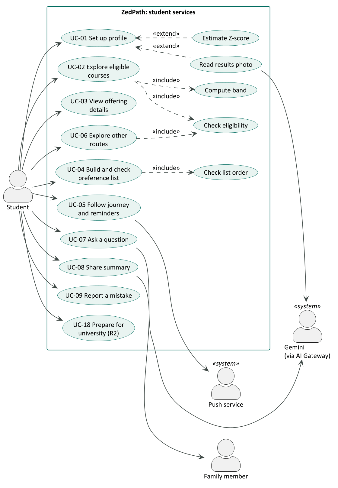
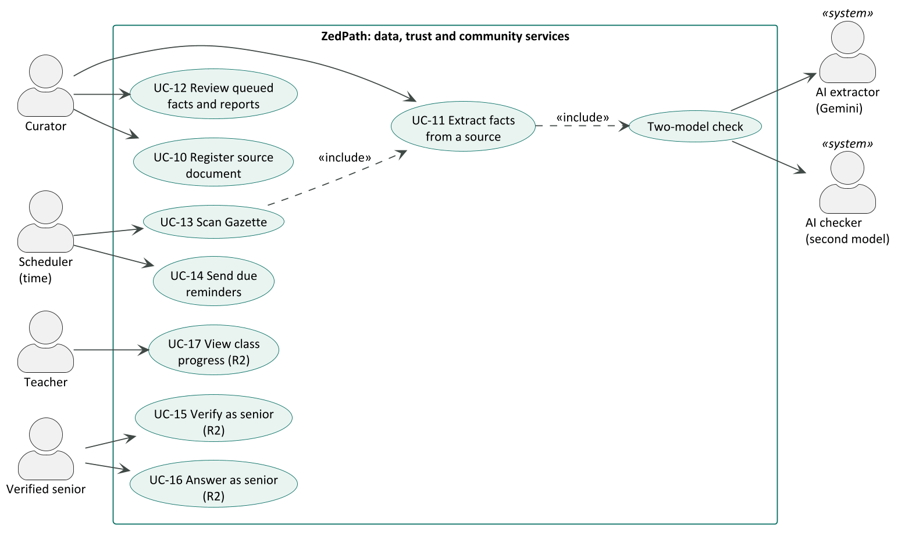
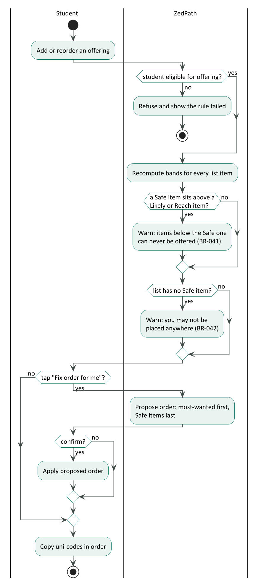
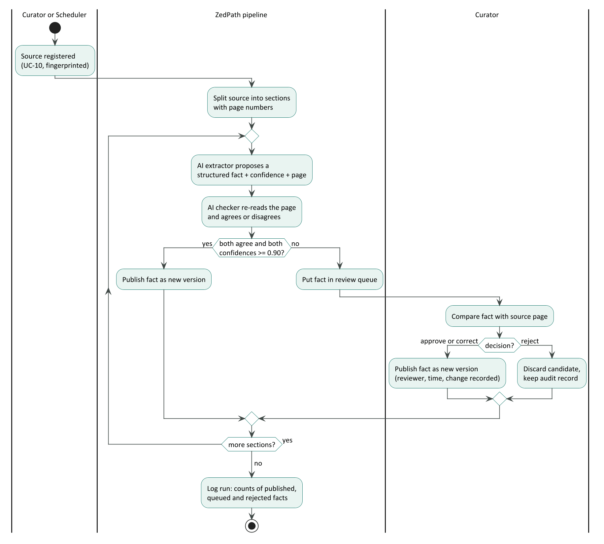

# Introduction

## Purpose

This document describes how each actor uses ZedPath to reach a goal. Where the user stories (ZP-DOC-02) say
*what* a user needs and the SRS (ZP-DOC-03) says *what the system shall do*, the use cases describe the
**interaction step by step**, including what happens when things go wrong. They are the basis for the screen
flows (ZP-DOC-07), the API design (ZP-DOC-06) and the system tests (ZP-DOC-08).

## Scope

Thirty-three use cases covering Releases R1 and R2: the eighteen of v1.0 (one now superseded) and fifteen added by
change requests CR-001 to CR-006. Eleven are written in Cockburn's *fully dressed* format because they carry the main
risk or value; the rest are given in *brief* format.

## Intended audience

Developers, testers, interface designers and reviewers.

## Relationship to other documents

Table: Position of this document in the ZedPath document set

| Document | Relationship |
|---|---|
| ZP-DOC-03 SRS | Parent. Each use case realises a group of functional requirements (listed per use case) |
| ZP-DOC-05 Data Design | Child. Nouns in the use cases name the entities |
| ZP-DOC-07 UI/UX Specification | Child. Main scenarios become screen flows |
| ZP-DOC-08 Test Plan | Child. Main scenarios and extensions become system test cases |

## Conventions

- Use case IDs are **UC-nn**. Goal level follows Cockburn: **user goal** (sea level) unless stated;
  **subfunction** for included steps.
- In scenarios, numbered steps are the main success path; extensions are numbered by the step they branch
  from (for example *3a*).
- *The system* means ZedPath.
- **Change markers** (since v1.0): *New (CR-nnn)*, *Revised (CR-nnn)* or *Superseded by X (CR-nnn)*. A superseded
  use case keeps its ID and text for traceability (it is *Deleted* in the sense of ZP-DOC-00). The change requests
  are listed in ZP-DOC-02 and ZP-DOC-03; "VR" is the product owner's video review of 11 October 2026.

# Actors

Table: Actors and their goals

| Actor | Type | Goals |
|---|---|---|
| Student (P1, P2) | Primary, human | Find every reachable path, avoid costly mistakes, never miss a deadline; *(CR-001 to CR-006)* keep one account and Journey on every device, talk with peers safely |
| Family member (P3) | Secondary, human | Receive a clear summary in their language |
| Teacher (P4) | Primary, human (R2) | See which students need help |
| Verified senior (P5) | Primary, human (R1 since CR-002) | Help juniors in a trusted space |
| Curator (P6) | Primary, human | Keep every published fact correct and sourced; *(CR-002)* issue senior invites |
| Scheduler | Primary, time | Run weekly Gazette scans and daily reminders. *Revised (CR-002):* reminders are now scheduled on the phone, so the scheduler only scans the Gazette |
| AI extractor (Gemini via AI Gateway) | Supporting, system | Propose structured facts from documents and photos; draft answers |
| AI checker (second model) | Supporting, system | Independently agree or disagree with each extracted fact |
| Push service | Supporting, system. *Superseded by the Android notification system (CR-002).* | Deliver web-push reminders to the student's browser |
| Android notification system | Supporting, system. *New (CR-002).* | Show the reminders the ZedPath Android app schedules on the phone |
| Moderation model (Workers AI) | Supporting, system. *New (CR-002).* | Judge each group message safe or unsafe before others see it |

# Use case diagrams

> **Note:** The two diagrams above show the v1.0 baseline. Use cases UC-19 to UC-33, added by the change requests, are
> defined in the catalogue and sections below; the diagrams will be redrawn before this revision is approved.

# Use case catalogue

Table: Use case catalogue with level, release and realised requirements

| ID | Use case | Primary actor | Level | Release | Requirements |
|---|---|---|---|---|---|
| UC-01 | Set up profile | Student | User goal | R1 | FR-101 to FR-113, FR-123, FR-124 |
| UC-02 | Explore eligible courses | Student | User goal | R1 | FR-201 to FR-207, FR-210 to FR-213, FR-215 to FR-217 |
| UC-03 | View offering details | Student | User goal | R1 | FR-208, FR-209, FR-214, FR-218 |
| UC-04 | Build and check preference list | Student | User goal | R1 | FR-301 to FR-308 |
| UC-05 | Follow journey and reminders | Student | User goal | R1 | FR-401 to FR-408, FR-417 |
| UC-06 | Explore other routes | Student | User goal | R1 | FR-501 to FR-510 |
| UC-07 | Ask a question | Student | User goal | R1 | FR-601 to FR-612, FR-913 |
| UC-08 | Share summary | Student | User goal | R1 | FR-701, FR-702 |
| UC-09 | Report a mistake | Student | Subfunction | R1 | FR-910, FR-912 |
| UC-10 | Register source document | Curator | User goal | R1 | FR-901, FR-902 |
| UC-11 | Extract facts from a source | Curator, Scheduler | User goal | R1 | FR-903 to FR-905 |
| UC-12 | Review queued facts and reports | Curator | User goal | R1 | FR-906, FR-907, FR-911 |
| UC-13 | Scan Gazette | Scheduler | User goal | R1 | FR-503, FR-504, FR-908, FR-909 |
| UC-14 | Send due reminders (*superseded by UC-28, CR-002*) | Scheduler | User goal | R1 | FR-405, FR-406 (both superseded) |
| UC-15 | Verify as senior (*revised, CR-002*) | Verified senior | User goal | R1 | FR-704 (superseded), FR-707 |
| UC-16 | Answer as senior (*revised, CR-002*) | Verified senior | User goal | R1 | FR-703, FR-705 |
| UC-17 | View class progress | Teacher | User goal | R2 | FR-706 |
| UC-18 | Prepare for university | Student | User goal | R2 | FR-801 to FR-804 |
| UC-19 | Create account and give contact details (*new, CR-001, CR-003*) | Student | User goal | R1 | FR-114, FR-116, FR-118, FR-120, FR-121 |
| UC-20 | Log in and restore profile (*new, CR-001*) | Student | User goal | R1 | FR-115, FR-117 |
| UC-21 | Recover account (*new, CR-001*) | Student | User goal | R1 | FR-118 |
| UC-22 | Delete account (*new, CR-001*) | Student | User goal | R1 | FR-119 |
| UC-23 | Choose an avatar (*new, CR-006*) | Student | User goal | R1 | FR-122 |
| UC-24 | Select several courses (*new, VR, CR-006*) | Student | User goal | R1 | FR-309 to FR-311 |
| UC-25 | Tick a Journey step (*new, CR-006*) | Student | User goal | R1 | FR-409 to FR-411 |
| UC-26 | Follow a course (*new, CR-006*) | Student | User goal | R1 | FR-411, FR-416 |
| UC-27 | Follow a notice and record applying (*new, CR-006*) | Student | User goal | R1 | FR-411, FR-414, FR-415 |
| UC-28 | Get reminders and set them (*new, CR-002, VR*) | Student | User goal | R1 | FR-404, FR-412, FR-413 |
| UC-29 | Take part in a group (*new, CR-002, CR-005*) | Student, Verified senior | User goal | R1 | FR-705, FR-708 to FR-712, FR-715, FR-716, FR-719 |
| UC-30 | Accept group rules (*new, CR-005, CR-006*) | Student, Verified senior | Subfunction | R1 | FR-713 (superseded), FR-714 |
| UC-31 | View group info and exit (*new, CR-006*) | Student, Verified senior | User goal | R1 | FR-717, FR-718 |
| UC-32 | Rate an answer (*new, CR-004*) | Student | Subfunction | R1 | FR-611 |
| UC-33 | Issue a senior invite (*new, CR-002*) | Curator | User goal | R1 | FR-707 |

# Fully dressed use cases

## UC-01 Set up profile

| | |
|---|---|
| Scope | ZedPath (system) |
| Level | User goal |
| Primary actor | Student |
| Change | *Revised (CR-001, CR-003):* an account now comes first (UC-19), and the profile is kept on the account as well as on the device (FR-117). |
| Stakeholders and interests | **Student:** quick entry, no mistakes, the same profile on every device. **Product owner:** personal data only with consent (NFR-030). |
| Preconditions | The student is logged in (UC-19 or UC-20). |
| Minimal guarantee | An invalid profile is never saved; a results photo is deleted after reading (extension 2b). |
| Success guarantee | A valid profile is stored on the device and on the account, and every results screen uses it. |
| Trigger | The student opens ZedPath without a stored profile, or chooses *Edit profile*. |

**Main success scenario**

1. The student chooses a stream.
2. The student chooses the district they sat from.
3. The student enters their Z-score.
4. The student chooses three subjects, searching the list if needed (FR-123), and the grade for each.
5. The system validates the Z-score (BR-005) and the subject combination for the stream (BR-010).
6. The system stores the profile on the device and on the account (FR-117) and shows the student's results (UC-02).

**Extensions**

- *2a. The student has no results yet:* the student enters expected marks; the system shows an estimated
  Z-score range (FR-107) and continues at step 4 using the lower bound, marked *Estimate*.
- *2b. The student chooses "Read my results sheet":* the student photographs the results sheet; the system
  reads the fields (FR-109), highlights low-confidence fields (FR-110), deletes the photo (FR-111), and the
  student confirms or corrects each field; continue at step 5.
- *5a. The Z-score is invalid:* the system shows an inline message next to the field (FR-102); resume at step 3.
- *5b. The subject combination is not admissible for the stream:* the system names the subject that does not
  fit (FR-103); resume at step 4.
- *\*a. At any time the student switches language:* all text changes; entered data is kept (FR-112). In Sinhala
  or Tamil the app says the text is an AI translation being checked (FR-124).
- *6a. The device is offline:* the profile is stored on the device and sent to the account when the device is
  online again, without being overwritten by the older copy (FR-117).

| | |
|---|---|
| Frequency | Once per student, then occasional edits |
| Open issues | Subject statistics for the estimate need at least three years of published data (DE-2) |

## UC-02 Explore eligible courses

| | |
|---|---|
| Scope | ZedPath (system) |
| Level | User goal |
| Primary actor | Student |
| Stakeholders and interests | **Student:** see every reachable course and an honest chance. **Product owner:** never imply certainty (FR-207). |
| Preconditions | A valid profile exists (UC-01). Cut-offs and rules for the intake year are published. |
| Minimal guarantee | Only courses whose rules the student meets are shown as eligible; no band is shown without data. |
| Success guarantee | The student sees eligible offerings grouped by band, and knows why any course is hidden. |
| Trigger | The student submits or changes their profile, or opens *Courses*. |

**Main success scenario**

1. The system sends the profile to the server.
2. The server applies the general eligibility rules (BR-001 to BR-004) and each offering's specific rules
   (BR-020 to BR-024) (*include: Check eligibility*).
3. The server bands each eligible offering against the district's cut-off history (BR-030 to BR-036)
   (*include: Compute band*).
4. The system shows counts per band and the list for the default band, each item with its gap to the latest
   cut-off and its trend.
5. The student filters by band, university, field or distance (FR-210).
6. The student opens an offering (UC-03) or adds it to the list (UC-04).

**Extensions**

- *2a. Some offerings fail a rule:* the system shows "N courses hidden" with a link to the reasons (FR-204).
- *3a. An offering has no numeric cut-off for the district (all NQC or new):* it is shown as *Not enough data*.
- *3b. The offering is selected on all-island merit:* the all-island cut-off is used for every district (BR-035).
- *5a. The student marks an offering as a dream course:* the system shows the gap and up to three nearby open
  offerings (FR-211, FR-212).
- *5b. Revised (VR): the student searches by name, short form or Uni-Code:* matching offerings from every band are
  listed (FR-215).
- *6a. Revised (VR): the student taps Compare:* the Compare screen opens with the offering in a swipeable column, and
  a "+" column adds up to three (FR-213, FR-216, FR-217).
- *6b. New (VR, CR-006): the student presses and holds offerings:* UC-24.
- *1a. The network is unavailable:* the system shows the last results computed on the device, marked with the
  time computed.

| | |
|---|---|
| Frequency | Several times per session during the application window |

## UC-04 Build and check preference list

| | |
|---|---|
| Scope | ZedPath (system) |
| Level | User goal |
| Primary actor | Student |
| Stakeholders and interests | **Student:** a list that cannot lock them out of a course they want more (E4). |
| Preconditions | UC-02 has run; at least one eligible offering exists. |
| Minimal guarantee | The list never contains an offering the student is not eligible for. |
| Success guarantee | The student has an ordered list with no unacknowledged ordering warnings, and has copied the uni-codes. |
| Trigger | The student taps *Add to my list* or opens *My list*. |

**Main success scenario**

1. The student adds an eligible offering; the system appends it with its band and uni-code.
2. The student reorders the list by drag and drop or keyboard.
3. The system re-checks the order after every change (*include: Check list order*) and shows any warnings
   (BR-041, BR-042).
4. The student resolves or acknowledges each warning.
5. The student taps *Copy uni-codes*; the system copies them in order, one per line (FR-306).

**Extensions**

- *1a. The offering is not eligible:* the system refuses and shows the failed rule (FR-302).
- *3a. The student taps "Fix order for me":* the system proposes an order (FR-305); the student confirms or
  cancels.
- *3b. The list exceeds the maximum number of preferences allowed (BR-043):* the system prevents further
  additions and explains the limit.

The decision logic of this use case is shown below.

## UC-07 Ask a question

| | |
|---|---|
| Scope | ZedPath (system) |
| Level | User goal |
| Primary actor | Student |
| Supporting actors | AI extractor (Gemini via AI Gateway) |
| Change | *Revised (CR-004, VR):* answers are shown as a card with a verdict, sources, actions, follow-ups and feedback; achievements and interests are used for the answer only. |
| Stakeholders and interests | **Student:** a correct answer in their language. **Product owner:** no unsupported or predictive answers (FR-604, FR-605); free-plan limits respected (NFR-034); achievements not stored (NFR-074). |
| Preconditions | None; a profile improves answers. |
| Minimal guarantee | No answer is shown without a source; rate limits are enforced. |
| Success guarantee | The student receives an answer in their language with at least one source link. |
| Trigger | The student submits a question on *Ask*. |

**Main success scenario**

1. The student types a question in Sinhala, Tamil or English; the app sends it with the student's profile,
   achievements and interests and the app language (FR-612).
2. The system passes the bot check and rate limit (FR-912, FR-913).
3. The system retrieves the stored source passages most relevant to the question (with the special-intake section
   when BR-080 says it may apply).
4. The system asks the AI model to answer **only** from those passages, using the student's profile and the facts
   computed by ZedPath's own rules where relevant, in the question's language.
5. The system shows the answer as a card: a verdict chip (FR-607), a lead line and bullets (FR-608), and source
   chips that open the quote and link to the official document (FR-609).
6. Under the answer, the system lists next-step actions built from its own data (FR-606) and follow-up questions
   (FR-610); the student may rate the answer (UC-32).

**Extensions**

- *2a. Rate limit exceeded:* the system asks the student to wait and states when they can ask again.
- *3a. No relevant passage is found:* the system states it does not know and gives the official contact (FR-604).
- *4a. The question asks for a future cut-off or a guarantee:* the system declines and shows the historical
  pattern instead (FR-605).
- *4b. The AI service is unavailable:* the system says Ask is temporarily unavailable; all other features keep
  working (NFR-040).
- *5a. The model gave no verdict:* no chip is shown (FR-607).
- *6a. The student taps an action:* the course opens, is added to the list (only when eligible) or to Compare, or the
  notice is added to the Journey (UC-27).

## UC-11 Extract facts from a source

| | |
|---|---|
| Scope | ZedPath back office |
| Level | User goal |
| Primary actor | Curator (or Scheduler, from UC-13) |
| Supporting actors | AI extractor; AI checker |
| Stakeholders and interests | **Students:** correct rules. **Curator:** review only what needs review. |
| Preconditions | The source is registered and fingerprinted (UC-10). |
| Minimal guarantee | No fact is published without a source page and either two-model agreement or curator approval. |
| Success guarantee | Every extractable fact is either published or queued for review; the run is logged. |
| Trigger | The curator starts extraction, or a new Gazette issue arrives (UC-13). |

**Main success scenario**

1. The system splits the source into sections with page numbers.
2. For each section, the AI extractor proposes structured facts with confidence and page.
3. The AI checker re-reads the page and agrees or disagrees with each fact (*include: Two-model check*).
4. Facts on which both agree with confidence at least 0.90 are published as new versions (FR-905).
5. All other facts enter the review queue (UC-12).
6. The system logs counts of published, queued and rejected facts.

**Extensions**

- *2a. A section cannot be read (scanned image without text):* the system uses vision extraction; if that
  fails, the section is queued for manual entry.
- *2b. The AI service fails or a limit is reached:* the step is retried with back-off (NFR-041); after three
  failures the run pauses and the curator is notified (FR-909).

## UC-12 Review queued facts and reports

| | |
|---|---|
| Scope | ZedPath back office |
| Level | User goal |
| Primary actor | Curator |
| Preconditions | The curator is signed in (NFR-032). |
| Success guarantee | Each reviewed item is approved, corrected or rejected, and the decision is recorded (FR-907). |
| Trigger | Items are waiting in the review queue or a mistake report arrives (UC-09). |

**Main success scenario**

1. The curator opens the queue, ordered by impact (facts used by most students first).
2. The system shows the source page, the proposed fact and both models' verdicts side by side.
3. The curator approves, corrects or rejects the item.
4. The system publishes approved or corrected facts as new versions and keeps the previous version (FR-911).

**Extensions**

- *2a. The item is a mistake report:* the system shows the reported fact, the student's note and the source;
  the curator corrects the fact or closes the report with a reason.

## UC-13 Scan Gazette

| | |
|---|---|
| Scope | ZedPath back office |
| Level | User goal |
| Primary actor | Scheduler |
| Success guarantee | Every new Gazette issue is stored, its relevant notices extracted, and matching students alerted (FR-503). |
| Trigger | Weekly schedule (every Monday, 06:00 Sri Lanka time). |

**Main success scenario**

1. The scheduler starts the weekly run.
2. The system fetches the list of new Gazette issues and stores each new file as a source (UC-10).
3. The system classifies notices and extracts job-examination details (UC-11).
4. *Revised (CR-002, CR-006):* published notices appear under the Journey's *Open now* tab, where each student's
   device checks the A/L-pass and age rules (FR-509, NFR-072).

**Extensions**

- *2a. The Gazette website is unreachable:* the run retries; after three failures it is marked failed and
  shown to the curator (FR-909).

## UC-19 Create account and give contact details

*New (CR-001; contact details and consent added by CR-003).*

| | |
|---|---|
| Scope | ZedPath (system) |
| Level | User goal |
| Primary actor | Student |
| Stakeholders and interests | **Student:** a quick, safe sign-up; knowing why each detail is asked. **Parent or guardian (P3):** agrees for a student under 18. **Product owner:** consent recorded and only the needed data kept (NFR-030, NFR-070). |
| Preconditions | The student is not logged in. |
| Minimal guarantee | No account and no detail is stored unless every rule and the consent are met; the password never leaves the device (NFR-036). |
| Success guarantee | An account exists with a username, a hashed key, contact details and a recorded consent version; the student has seen and confirmed the recovery code, and is logged in. |
| Trigger | The student opens ZedPath without a session and chooses *Create account*. |

**Main success scenario**

1. The student enters a username and a password.
2. The student enters full name, email address, Sri Lankan mobile number and date of birth; the screen states what
   each is used for and that email and mobile are not verified yet (FR-121).
3. The student ticks the consent statement, which includes a parent's or guardian's agreement for a student under 18.
4. The device checks every field (BR-050 to BR-055) and derives a key from the password (FR-114).
5. The system checks the same rules again, stores the account, its contact details and the consent version and time
   (BR-057), and starts a session.
6. The system shows the recovery code once; the student confirms that it is saved (FR-118).
7. The student continues to *About you* (UC-01).

**Extensions**

- *4a. A field breaks a rule:* the device names the field; resume at the step for that field.
- *5a. The username is taken:* the system says so; resume at step 1.
- *5b. A request reaches the server without consent or with an invalid detail:* the server refuses it and stores
  nothing (FR-116).
- *5c. Too many attempts from one network:* the system asks the student to wait (NFR-037).
- *1a. The student has a senior invite code:* the student enters it; the system creates a verified senior account
  for the course on the invite, which keeps no A/L results (UC-15).
- *\*a. The student's account was made before CR-003:* on the next open the system asks for the contact details and
  consent before any other screen (FR-120).

| | |
|---|---|
| Frequency | Once per student |

## UC-25 Tick a Journey step

*New (CR-006).*

| | |
|---|---|
| Scope | ZedPath (system) |
| Level | User goal |
| Primary actor | Student |
| Stakeholders and interests | **Student:** a Journey that shows what they have really done. **Product owner:** no invented dates; the rule enforced on the server (NFR-038). |
| Preconditions | The student is logged in. |
| Minimal guarantee | A step outside its window is never stored as done. |
| Success guarantee | The step is stored as done on the account, with its time, and shown ticked on every device (FR-411). |
| Trigger | The student taps a step's tick box in the Journey. |

**Main success scenario**

1. The system shows the Journey steps in order, all unticked for a new account (FR-409).
2. The student taps the tick box of a step whose window is open: a preparation step at any time, or a UGC step on
   or after the opening date in the UGC press notice (BR-061).
3. The system checks the window again on the server against the same dated data the device shows (FR-410).
4. The system stores the step as done on the account and shows it ticked.

**Extensions**

- *2a. The step is a UGC step whose date is not announced or not reached:* the tick box is disabled and says why;
  the use case ends.
- *3a. A tick outside the window reaches the server anyway:* the server refuses it and stores nothing.
- *2b. The student unticks a ticked step:* the system removes the done mark from the account.
- *\*a. There is no valid session:* the server refuses the request (US-411).

| | |
|---|---|
| Frequency | A few times per student per admission cycle |

## UC-29 Take part in a group

*New (CR-002; extended by CR-005 and CR-006).*

| | |
|---|---|
| Scope | ZedPath (system) |
| Level | User goal |
| Primary actor | Student or verified senior |
| Supporting actors | Moderation model (Workers AI) |
| Stakeholders and interests | **Student, often under 18:** honest answers without harassment or exposure of contact details. **Verified senior:** a badge that others cannot copy. **Product owner:** abuse stopped on the server, within free-plan limits. |
| Preconditions | The student is logged in. For a batch group, the student's results are saved on the account (BR-071). |
| Minimal guarantee | No message is shown to others without passing moderation; no real name, contact detail or photograph is shown (NFR-071). |
| Success guarantee | The student is a member, has accepted the current rules, and can read and post in the room. |
| Trigger | The student opens *Groups*. |

**Main success scenario**

1. The system lists the groups for the courses on the student's list, the student's batch group, the joined groups
   and the popular course groups (FR-705, FR-715).
2. The student chooses *Join* on a group.
3. If the account has not accepted the current group rules, the student accepts them (*include: UC-30*).
4. The system adds the student as a member, creating the group if it is the first join (BR-070).
5. The student opens the room; the system checks membership and rules acceptance and connects the room (NFR-038).
6. The room shows labelled sample conversations, if any, and the latest messages (FR-716).
7. The student writes a message; the room checks it (text, length, rate, no phone number or email) and the
   moderation model judges it safe (FR-708, FR-709, FR-712).
8. The room shows the message, with the student's username, avatar and any senior badge, to every member who has
   not blocked the student.

**Extensions**

- *3a. The student does not accept the rules:* the student is not joined; the use case ends.
- *5a. The connection drops:* the app reconnects by itself without showing "Disconnected" (FR-719, NFR-043).
- *7a. The message breaks a rule, or posting is too fast:* the room refuses it and says why; resume at step 7.
- *7b. The moderation model judges it unsafe or cannot judge it:* the message is not posted (NFR-039).
- *8a. The student reports a message with a reason:* the report is recorded once; at three reports from different
  members the message is hidden for everyone (FR-710).
- *8b. The student blocks a member:* that member's messages are no longer shown to the student (FR-711).
- *8c. The student opens the group's info page or leaves:* UC-31.

| | |
|---|---|
| Frequency | Daily for active students in the application season |

## UC-30 Accept group rules

*New (CR-005); revised by CR-006 from once per membership to once per account.*

| | |
|---|---|
| Scope | ZedPath (system) |
| Level | Subfunction |
| Primary actor | Student or verified senior |
| Stakeholders and interests | **Members:** everyone has agreed to the same rules. **Product owner:** acceptance recorded and enforced on the server. |
| Preconditions | The student is logged in and has asked to join a group (UC-29, step 2). |
| Minimal guarantee | No live room opens for an account that has not accepted the current rules version. |
| Success guarantee | The account's acceptance of the current version is recorded with its time (FR-714). |
| Trigger | A first join of any group, or the first join after a new rules version. |

**Main success scenario**

1. The system shows the six group rules in the student's language (BR-074).
2. The student ticks that they have read the rules and will follow them, and taps *Agree and join*.
3. The system records the acceptance of the current version for the account and completes the join in the same
   batch.

**Extensions**

- *1a. The account has already accepted the current version:* the rules are not shown; the join continues.
- *3a. A first join reaches the server without acceptance:* the server refuses the join (FR-714).
- *\*a. Superseded behaviour (CR-005, FR-713):* acceptance was asked for every group the student joined; CR-006
  replaced it with one acceptance per account per version.

# Brief use cases

Table: Brief use cases

| ID | Use case | Brief description |
|---|---|---|
| UC-03 | View offering details | The student opens an offering and sees its district cut-off history with their own Z-score, duration, medium, aptitude-test flag and first-year content, each with its source. |
| UC-05 | Follow journey and reminders | *Revised (CR-002, CR-006).* The student sees the Journey steps in order, the followed courses and notices, and the next dated item first; a UGC date not yet announced shows *Not announced yet* with the official rule and page; aptitude-test steps are added automatically. The *Open now* tab lists open notices, and the Journey tab shows the count of new ones. Steps are ticked in UC-25 and reminders set in UC-28. (v1.0: dates confirmed or estimated; push reminders.) |
| UC-06 | Explore other routes | *Revised (VR).* The student sees six groups of non-UGC routes (the retry group was removed), each marked open or not open with the reason, and opens a route's requirements, cost and timing with sources; open notices show whether the student meets their A/L-pass and age rules, checked on the device. |
| UC-08 | Share summary | The student generates a card in a chosen language, without name or Z-score unless added, and sends it through the phone's share sheet. |
| UC-09 | Report a mistake | From any fact, the student taps *Report a mistake*, adds an optional note and passes a bot check; the report is queued for the curator. |
| UC-10 | Register source document | The curator uploads an official document with its metadata; the system stores it unchanged, fingerprints it and rejects duplicates. |
| UC-14 | Send due reminders | *Superseded by UC-28 (CR-002): reminders are scheduled on the phone, not sent by the server.* Daily, the scheduler finds deadlines due in 7 days or 1 day for subscribed students and sends web-push reminders; expired subscriptions are deleted. |
| UC-15 | Verify as senior | *Revised (CR-002): R1; invite codes replace Google accounts and proof review.* A university student receives a one-time invite code from the product owner (UC-33), enters it while creating an account (UC-19), and gets a verified senior account for the course, institution and year on the invite; a used or expired code is refused. |
| UC-16 | Answer as senior | *Revised (CR-002): R1, in groups.* A verified senior answers questions in the course groups (UC-29); messages show the badge "Verified senior · course, year". |
| UC-17 | View class progress (R2) | A teacher sees aggregate progress of students who shared with the class code, and names only of those who shared. |
| UC-18 | Prepare for university (R2) | A selected student follows the university's registration checklist, checks Mahapola and bursary eligibility, plans the months before lectures and keeps a documents checklist. |
| UC-20 | Log in and restore profile | *New (CR-001).* The student logs in with username and password on any device; the device derives the key, the server checks it and starts a 30-day session, and the profile, achievements, interests and Journey are restored. The student may log out on this device or on every device. |
| UC-21 | Recover account | *New (CR-001).* A student who forgot the password enters username, recovery code and a new password; the password is changed, a new recovery code is shown once, and the old code stops working. |
| UC-22 | Delete account | *New (CR-001).* The student confirms *Delete account*; the server deletes every row stored under the account and its messages in every group, the device is cleared, and the welcome screen is shown. |
| UC-23 | Choose an avatar | *New (CR-006).* In *Me*, the student picks one of 12 preset avatars or keeps the initials; the server accepts only the presets, and the avatar appears in the app bar, member lists and new group messages. |
| UC-24 | Select several courses | *New (VR, CR-006).* In *Courses* or *My list*, the student presses and holds a course and ticks others; from *Courses* they add all selected courses to the list under the usual rules, and from either screen they open Compare with up to three in the order selected. |
| UC-26 | Follow a course | *New (CR-006).* On a course page the student follows (or unfollows) the course; the server accepts only 2025/26 offerings and saves it on the account, and it appears in the Journey. |
| UC-27 | Follow a notice and record applying | *New (CR-006).* From *Open now* or an other-path page the student follows a notice or path, which appears in the Journey with its closing date; once the notice has opened the student may tick *I applied*; earlier, the tick is refused on the server. |
| UC-28 | Get reminders and set them | *New (CR-002, VR; supersedes UC-14).* In the Android app the phone schedules notifications 7 days and 1 day before each dated item; elsewhere the student downloads a calendar file. In *Me* the student chooses which reminders, 8 am or 6 pm, and whether the new-notice count shows; defaults keep the earlier behaviour. |
| UC-31 | View group info and exit | *New (CR-006).* In a room the student taps the group's name and sees the description, the general and group-specific rules and the member list (usernames, avatars, badges; members only), and may tap *Exit group* at the bottom. |
| UC-32 | Rate an answer | *New (CR-004).* Under an Ask answer the student taps *Helpful*, or *Report a wrong answer* with an optional note after being told the question and answer will be sent; the rating is stored without anything that identifies the student. |
| UC-33 | Issue a senior invite | *New (CR-002).* After checking a university student's enrolment, the product owner creates a one-time invite code for a course, institution and year of study, valid for 14 days, and gives it to the student privately; only its hash is stored. |

# Traceability: requirements to use cases {.appendix}

Every functional requirement in ZP-DOC-03 is realised by at least one use case, as listed in the use case
catalogue above (column *Requirements*); this was checked by script against all 80 requirements of v1.0, and
again for this revision against all 128 functional requirement IDs of ZP-DOC-03 v2.0, including the
superseded and withdrawn ones, which stay listed against the use case they belonged to.

# Glossary {.appendix}

Table: Terms used in this document

| Term | Meaning |
|---|---|
| Extension | An alternative path that branches from a step of the main success scenario |
| Fully dressed | Cockburn's complete use case format with stakeholders, guarantees, scenario and extensions |
| Include | A UML relationship: the base use case always performs the included use case |
| Extend | A UML relationship: the extending use case optionally adds behaviour to the base use case |
| Minimal guarantee | What the system promises even when the goal fails |
| Subfunction | A use case below user-goal level, performed as part of another |

# References {.appendix}

Table: Sources referred to in this document

| Ref | Source |
|---|---|
| [1] | A. Cockburn, *Writing Effective Use Cases*, Addison-Wesley, 2001 |
| [2] | Object Management Group, *Unified Modeling Language*, version 2.5.1, 2017 |
| [3] | ZP-DOC-02 User Stories; ZP-DOC-03 Software Requirements Specification |
