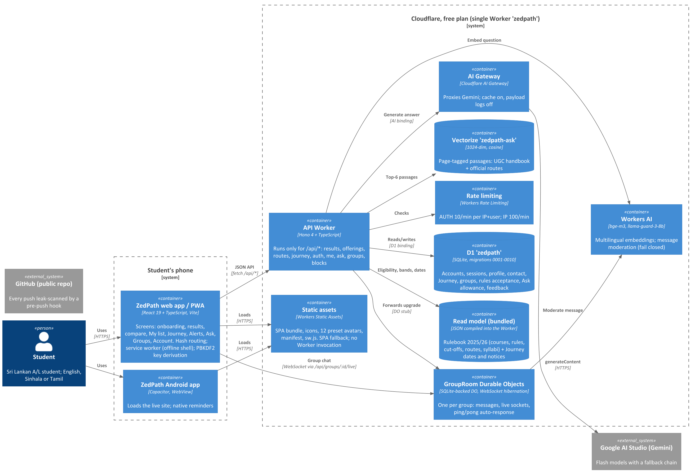
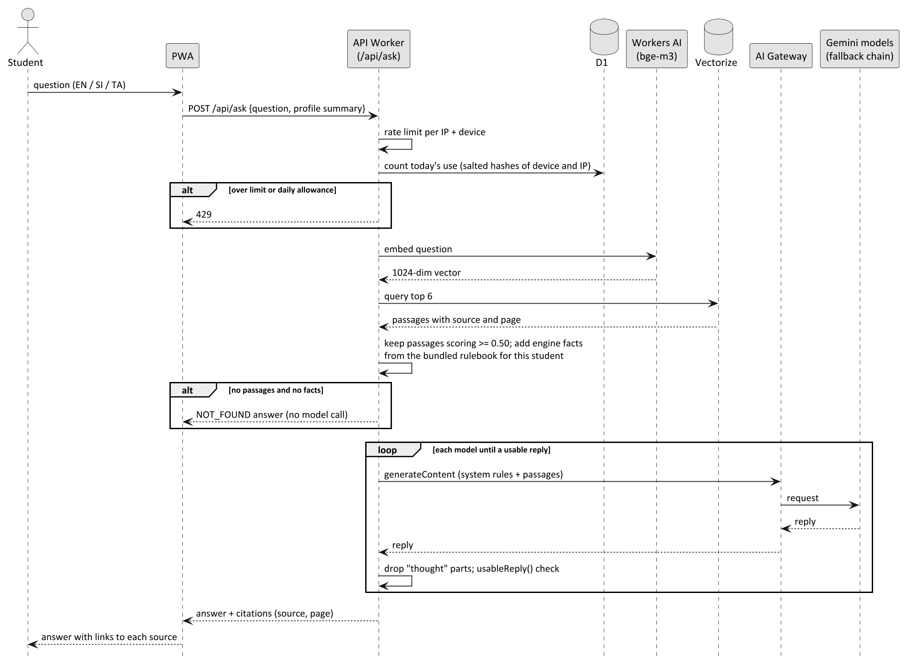

# Introduction

## Purpose

This document describes how ZedPath is built and deployed: the parts of the system, how they talk to each other,
why each major choice was made, and how the system stays inside the Cloudflare free plan. It is written from the
code as deployed, not from intentions; where something is designed but not yet running, it says so.

## Scope

The whole of Releases R1 and R2: the web application (also installable as a progressive web app and wrapped by the
Android app), the single Cloudflare Worker that serves it and its API, the data and AI services that Worker binds
to, the offline data pipeline that compiles the read model, and the release and safety tooling around deployment.

## Intended audience

Developers, reviewers and buildathon judges assessing how the system works and whether it is sound.

## Relationship to other documents

Table: Position of this document in the ZedPath document set

| Document | Relationship |
|---|---|
| ZP-DOC-01 Vision and Scope | Grandparent. Business objectives BO-1 and BO-6 (free to run, at scale) shape the platform choice |
| ZP-DOC-02 User Stories | Grandparent. Stories US-101 to US-204 define the walking skeleton built first |
| ZP-DOC-03 SRS | Parent. Constraints CON-1 to CON-5 and the non-functional requirements NFR-001 to NFR-080 are the architectural drivers |
| ZP-DOC-04 Use Case Model | Parent. Use-case flows become the runtime flows of Section 6 |
| ZP-DOC-05 Data Design | Sibling. Owns the D1 schema; this document decides how the read and write paths use it |
| ZP-DOC-07 UI/UX, ZP-DOC-08 Test Plan | Children. Screens built on the components here; tests that prove the NFRs |

# Architectural drivers

## Constraints

Table: Binding constraints (from ZP-DOC-03)

| ID | Constraint | Architectural consequence |
|---|---|---|
| CON-1 | Cloudflare free plan only | 10 ms CPU per request, 100,000 Worker requests a day, Workers AI 10,000 neurons a day; static assets free and unlimited. Every choice below is checked against these |
| CON-2 | TypeScript everywhere | One language across client, Worker, shared rule engine and tooling; types in `shared/` are imported by both sides |
| CON-3 | Material Design 3 | React components styled to MD3 tokens; no heavy UI framework (keeps NFR-006) |
| CON-4 | No email, SMS or WhatsApp | Reminders are local notifications on the device (PWA and Android); account recovery uses a recovery code, not email |
| CON-5 | Official documents cited, not redistributed | The read model holds extracted facts with source and page; Ask returns citations, not files |

## Quality attributes

Table: Non-functional requirements that shape the architecture

| NFR | Requirement (summary) | How the architecture meets it |
|---|---|---|
| NFR-003, NFR-005 | API under 500 ms; under 10 ms CPU per request | Eligibility and bands computed from a read model compiled into the Worker (no database round trip); D1 only for account data (ADR-01, ADR-02) |
| NFR-007 | Revalidate instead of re-download | One ETag per build of the read models; `If-None-Match` compared after stripping the weak prefix `W/` that compression adds, so 304 is answered (test-campaign finding D-05) |
| NFR-010, NFR-011 | 10,000 students per cycle; quotas below 70% on a typical day | Free-plan budget, Section 8 |
| NFR-012 | Page navigation uses no Worker requests | Static assets with `run_worker_first` limited to `/api/*`; SPA fallback for every other path |
| NFR-006, NFR-063 | Small first download; runs in any browser, installable | Vite + React SPA, code split; service worker `public/sw.js` caches the shell |
| NFR-033 | Secrets never in source | Wrangler secrets (`GEMINI_API_KEY`, `PEPPER`); `.dev.vars` locally, gitignored; pre-push leak scan |
| NFR-034, NFR-037 | Ask and sign-in limits | Workers Rate Limiting bindings plus a daily allowance in D1 keyed by salted hashes |
| NFR-035, NFR-038 | Validation and rules enforced on the server | Every write re-checked in the Worker; bound parameters only; 4xx with a field name on rejection |
| NFR-036 | Password never leaves the device | PBKDF2-SHA256, 600,000 iterations, on the phone; server stores SHA-256 of the derived key (ADR-04) |
| NFR-039 | Moderation fails closed | GroupRoom calls llama-guard before posting; unreadable verdict means not posted |
| NFR-040 | Core browsing works without AI | AI is reached only by `/api/ask` and group posting; results, courses, list and Journey never call it |
| NFR-043 | Idle group connection stays open | WebSocket hibernation with a ping/pong auto-response that does not wake the room (ADR-03) |
| NFR-054 | No data links a page blocked during research | Blocked pages kept as SHA-256 fingerprints in `tools/research/blocked-pages.ts`; data test DAT-054 scans every URL in `data/` and the compiled rulebook (ADR-08) |
| NFR-076 | Cross-site, "null" and malformed Origins refused with 403 | One function, `crossSite()` in `worker/account.ts`, used by the account, Journey and group middleware and by both Ask routes; a URL that cannot be parsed counts as cross-site |
| NFR-077 | No chat outlives its session or membership | `kickFromRooms()` asks each affected `GroupRoom` to close the sockets opened under the session or by the member (Section 6.6) |
| NFR-081, NFR-082 | Per-account and per-network limits | `accountBudget` middleware (100 writes a minute per account, on the `IP_LIMITER` binding with an account key) on `/me`, `/me/*`, groups and blocks; `ipBucket()` keys IPv6 clients by their /64 network |
| NFR-083 | Developer tools unreachable from outside | Ask `/dev/*` answers only on localhost with `DEV_TOOLS=1` and refuses a cross-site call even there |
| NFR-050, NFR-051 | Every fact cited; exact cut-offs | Read model carries source and page per fact; Z-scores stored as integers in ten-thousandths |
| NFR-060, NFR-062 | Rules as tested pure functions; new year without code changes | Rule engine in `shared/` (pure, unit tested); the yearly read model is regenerated by `tools/` |

# System context

ZedPath has one human actor in production, the **student** (with a **senior** variant who joins groups by
invitation). It depends on three external systems: **Cloudflare** (hosting, data, AI), **Google AI Studio**
(Gemini models, reached only through Cloudflare AI Gateway) and **GitHub** (public source repository). The
University Grants Commission (UGC) is a *source* of data, not a runtime dependency: its handbook and cut-off
tables are processed offline into the read model.

Table: External systems and what crosses each boundary

| External system | Direction | What crosses | Protection |
|---|---|---|---|
| Student's browser or Android app | In | HTTPS requests, WebSocket for group chat | Rate limits, session cookie, server-side validation |
| Google AI Studio (Gemini) | Out | Question, retrieved passages, engine facts (no name, contact or account id) | Through AI Gateway; key held as a Worker secret; payload logging off |
| GitHub | Out (developer only) | Source code | Pre-push leak scan of every new commit |
| UGC publications | Offline input | Handbook and cut-off PDFs | Processed on the developer laptop; facts verified by two extraction methods (NFR-052) |

# Container and deployment view

All server-side code is **one Cloudflare Worker** named `zedpath`. It serves the built single-page application as
static assets and runs a Hono API only for paths under `/api/`. Everything else it needs is a binding declared in
`wrangler.jsonc`.

Table: Containers and bindings (from wrangler.jsonc)

| Container | Technology | Binding | Role |
|---|---|---|---|
| Web app / PWA | React 19, TypeScript, Vite; hash routing; service worker | (static assets) | All screens; keeps the preference list and compare on the device; derives the password key |
| Android app | Capacitor WebView | (loads the live site) | Same app in its own window; native reminders |
| Static assets | Workers Static Assets | `assets` (SPA fallback, `run_worker_first: /api/*`) | Serves the bundle, icons, 12 preset avatars, manifest, `sw.js`; free and unlimited |
| API | Hono 4 on Workers | `main: worker/index.ts` | JSON API; mounts account, Journey, Ask and group routes |
| Read model | JSON compiled into the Worker | (bundled) | `worker/generated/rulebook-2025-2026.json` and `journey-2025-2026.json`: courses, rules, five years of cut-offs, routes, syllabi, Journey dates and notices. *Added 15 October 2026:* `worker/generated/statistics-2024.json` (university facts, CR-008) and `data/aptitude/aptitude-2025-2026.json` (aptitude notices, CR-009) |
| Database | Cloudflare D1 (SQLite) | `DB` | Accounts (including demo accounts, CR-007), sessions, profile, contact, Journey, groups, rules acceptance, Ask allowance, answer feedback (migrations 0001 to 0012; 0012 adds `group_room_seen`, the rooms an account opened) |
| Group rooms | Durable Objects, SQLite storage | `GROUP_ROOM` (class `GroupRoom`) | One object per group: messages and live WebSockets, with hibernation |
| Embeddings and moderation | Workers AI | `AI` | `@cf/baai/bge-m3` (multilingual, 1024 dimensions); `@cf/meta/llama-guard-3-8b` for messages |
| Retrieval index | Vectorize `zedpath-ask` | `ASK_INDEX` | Page-tagged passages from the UGC handbook and official routes; cosine |
| Model gateway | AI Gateway | via `AI.gateway()` | Proxies Claude Haiku 5.5 (first) and Gemini (fallback); cache on; payload logs off |
| Rate limiting | Workers Rate Limiting | `AUTH_LIMITER`, `IP_LIMITER` | 10 a minute per IP and username; 100 a minute per IP |

**Scheduled jobs.** ZP-DOC-03 provides for a weekly Cron job to check the Gazette and official notices. In this
release no Cron trigger is configured: Journey dates and notices are compiled into the read model by
`tools/journey` and shipped with each deploy (ADR-02). The Cron job is planned (Risk R-05).

# Component view

## Worker modules

Table: Worker components (worker/)

| Module | Routes | Responsibility |
|---|---|---|
| `index.ts` | `GET /health`, `/meta`, `POST /results`, `GET /offerings/:uniCode`, `/routes`, `/journey` | Read path: eligibility and Safe/Likely/Reach bands from the bundled read model; the course detail adds the institution's university facts (`facts`) and, for offerings with a test, the aptitude notice (`aptitude`); ETag caching keyed to the rulebook, syllabus, Journey and statistics builds, with weak ETags accepted |
| `account.ts` | `/auth/salt`, `/auth/signup`, `/auth/login`, `/auth/recover`, `/auth/demo`, `/auth/logout(-all)`, `GET/PUT/DELETE /me`, `/me/contact`, `/me/avatar` | Accounts and sessions; the `/me/*` session middleware; `crossSite()` and the `sameOrigin` middleware; `accountBudget` and `ipBucket()` (CR-010); the demo account with its cap of 500 and bounded clean-up (CR-007, CR-010); `kickFromRooms()`, which closes group sockets when a session or membership ends (CR-010); full account deletion including every group room the account is in or ever opened (`group_room_seen`, CR-010) |
| `my-journey.ts` | `/me/journey`, `/me/journey/courses/:uni`, `/notices/:route`, `/notices/:route/applied`, `/steps/:stepId` | The student's Journey on the account; step and notice windows enforced (409) |
| `ask.ts` | `POST /ask`, `/ask/feedback`; localhost-only `/dev/*` | Retrieval, engine facts, Gemini generation with fallback, reply guard, daily allowance per device and network plus a whole-service cap of 3,000 questions a day; feedback capped at 2,000 a day and kept one year; both routes, and the developer tools, refuse cross-site requests through `crossSite()` |
| `groups.ts` | `/groups`, `/groups/join`, `/groups/:id`, `/leave`, `/live`, `/members`, `/report`, `/blocks` | Membership and rules acceptance in D1; forwards the WebSocket upgrade to the room with the session hash and a read-only flag for demo accounts; refuses group creation and reports by demo accounts; counts toward hiding only reports from accounts at least a day old and not demo; records each room opened in `group_room_seen`; rate-limits `/live` per account |
| `group-room.ts` | (Durable Object) | Message storage, moderation, broadcast, hibernation, ping/pong; refuses posts on read-only sockets; counts post attempts before moderation (20 per 10 minutes); keeps at most three sockets per account; refuses contact details by `looksLikeContact()` in `shared/groups.ts`, which also checks a normalised copy; `/kick` closes the sockets of one session or of one account |
| `rulebook.ts`, `syllabi.ts` | (internal) | Load and index the read model; syllabus data and the blocked-hosts list |

## Client screens

The client (`src/`) is a Vite + React 19 SPA with hash routing, so every navigation stays on the static asset and
never calls the Worker (NFR-012). Screens in `src/screens/`: Onboarding (results entry), Compare, MyList, Journey,
Alerts, Ask, Groups, Syllabus and Account. `src/i18n/` holds English, Sinhala and Tamil strings (NFR-023).
`src/pwa.ts` registers the service worker; `src/notify.ts` schedules local reminders.

## Shared rule engine

`shared/` is imported by both the client and the Worker, so a rule exists exactly once. It holds the eligibility
rules (`rules.ts`), banding to BR-030 to BR-036 (`banding.ts`, integer Z-scores), preference-list checks
(`list.ts`), Journey windows (`journey.ts`), the key-derivation constants (`kdf.ts`, `account.ts`), group rules
(`groups.ts`) and the API types (`api.ts`). Each has unit tests beside it (NFR-060, NFR-061). *Added 15 October 2026:*
the sample student used by both demo paths (`demo-data.ts`, CR-007) and the types of the university facts
(`statistics.ts`, CR-008).

## Offline data pipeline

`tools/` compiles verified data into the read model before a build (ADR-02). *Added 15 October 2026:*
`tools/statistics/build-statistics.ts` compiles the double-checked extracts of the UGC report *Sri Lanka University
Statistics 2024* (`data/ugc/statistics-2024/*.json`, Chapters 2, 3, 4 and 7) into `worker/generated/statistics-2024.json`:
96 facts for 20 institutions, keyed by institution letter, each with its table, PDF page and link, and the report's
caveats as flags. The aptitude notices (`data/aptitude/aptitude-2025-2026.json`: 13 official notices covering 22 Uni-Codes,
and 2 Uni-Codes whose joint practical test is held at other universities) are imported by the Worker as they are.
`tools/research/check-url.ts` tells a research agent whether a URL is on a blocked host or a blocked page before it is
fetched (ADR-08).

# Key runtime flows

## Results to bands

1. The student enters stream, subjects, grades, district and Z-score in Onboarding.
2. The client posts the profile to `POST /api/results`.
3. The Worker validates it (`parseProfile`), then for every offering in the bundled rulebook runs the eligibility
   rules and the banding function. No D1 read is involved, so the request stays well under 10 ms CPU.
4. The response lists each offering with its band, years used, latest cut-off and trend, plus hidden offerings
   with the quoted reason and handbook page (NFR-050).

## Ask with citations

Two guards matter. Passages below a similarity of 0.50 (calibrated on Sinhala and Tamil questions) are dropped, and
when nothing relevant remains the Worker answers "not found" without calling a model. Each model reply passes
`usableReply()`, which rejects a reply that talks about its own instructions. Since 24 October 2026, when
`ANTHROPIC_API_KEY` is set, **Claude Haiku 5.5** (`claude-haiku-5-5`, Anthropic Messages API through the same AI Gateway)
answers first; any error or unusable reply falls back to the Gemini chain. In that chain the next model
(`gemini-flash-latest`, `gemini-2.5-flash`, `gemini-flash-lite-latest`, `gemini-2.5-flash-lite`) is then asked.
A model that is missing, busy or out of quota (404, 429, 5xx) also falls through to the next.

## Joining a group, rules accepted once

1. The client posts `POST /api/groups/join` with the group kind and, the first time, `acceptRules` set to the
   current rules version.
2. The Worker refuses (400) unless the rules are accepted in this request or were accepted before
   (`group_rules_acceptance`, one row per account and version).
3. A batch group requires results saved to the account (403 otherwise).
4. Group creation, rules acceptance and membership are written in one D1 batch with `INSERT OR IGNORE`, so a repeat
   join is harmless.
5. `GET /api/groups/:id/live` checks membership, then forwards the WebSocket upgrade to the group's GroupRoom, with
   the username added by the Worker (the client cannot claim another name).

## Journey step window (409)

A Journey step can be ticked *done* only once its official window has opened. The client greys the tick out, but
the rule is enforced in `PUT /api/me/journey/steps/:stepId`: the Worker computes `stepWindow()` from the bundled
Journey dates and Sri Lanka's date, and returns **409** "This step has not opened yet" if it is closed. *I applied*
on a notice follows the same rule (409 before the notice opens; 404 if not followed). The same shared function
drives the client, so the two cannot disagree (NFR-038).

## Try the demo (CR-007)

1. The Welcome screen posts `POST /api/auth/demo` (no body). The request passes `sameOrigin` and the log-in rate limits.
2. The Worker deletes every account whose `demo_expires_at` has passed; the foreign keys cascade to every row under
   it. The partial index `idx_account_demo_expires` serves this without scanning real accounts (ZP-DOC-05, migration 0011).
3. In one D1 batch it creates the account with `demo_expires_at` 24 hours ahead, a `password_login` row with a random
   username (`demo_` and eight hexadecimal digits) and a random, unusable verifier, a session, and the sample student's
   contact, profile, achievements and interests from `shared/demo-data.ts`, normalised by the same functions as a
   sign-up.
4. It sets the session cookie for 24 hours and answers `201` with the account, flagged `demo: true`.
5. In groups, `isDemo()` lets the account join only groups that already exist (403 otherwise) and refuses reports
   (403); `/live` forwards the upgrade with a read-only flag, and the room refuses every post on that socket.

## Ending a session closes open chats (CR-010)

1. `POST /api/auth/logout` deletes the session row, then calls `kickFromRooms()` with the account and the session's
   token hash; log out everywhere and recovery call it with the account only; leaving a group calls it for that group only.
2. `kickFromRooms()` lists the account's groups and posts `/kick` to each `GroupRoom` (all calls in parallel, failures
   ignored).
3. Each room closes the sockets of that account, only those opened under that session when a session is given, with
   close code 1008. The Worker had added the session hash to each socket's attachment when it forwarded the upgrade.
4. A room that cannot be reached closes the socket at its next message, because the membership and session checks no
   longer pass.
5. Account deletion goes further: before the cascade, the Worker reads every group the account is in or ever opened
   (`group_member` united with `group_room_seen`, at most 45 rooms per request, the free-plan subrequest limit) and asks
   each room to purge the account's messages and close its sockets (ZP-DOC-05, migration 0012).
6. On the phone, stored results, list and Journey are tagged with the owner's username; a different student logging in
   clears them first, and a failed log-out is reported instead of being shown as success.

## Course page: university facts and aptitude test (CR-008, CR-009)

`GET /api/offerings/:uniCode` adds two blocks from the read model, without any D1 read: `facts`, the institution's
facts from the statistics file (matched by the last letter of the Uni-Code), and `aptitude`, the official notice for an
offering with a test. `aptitudeFor()` marks the notice `past` when the later of its closing date and test date is before
today's Sri Lanka date; for the two Uni-Codes whose joint practical test is held elsewhere it returns the notices of the
universities that hold it. The ETag includes the statistics retrieval date, so a data change reaches phones at once.

# Security

Table: Security controls

| Area | Control |
|---|---|
| Passwords | PBKDF2-SHA256, 600,000 iterations, run on the device; only the derived key is sent; the server stores its SHA-256 with a per-user salt derived from a server-side pepper (NFR-036, ADR-04) |
| Sessions | Random token in a cookie: `HttpOnly`, `Secure`, `SameSite=Lax`, path `/api`; only the token's hash is stored; *log out everywhere* deletes all sessions |
| Abuse | Rate limiting on sign-up, log-in and Ask; daily Ask allowance keyed by salted, day-scoped hashes (no raw IP stored) |
| Server-side enforcement | Validation, membership, rules acceptance, Journey windows, moderation: all in the Worker or Durable Object; the UI only mirrors them |
| Privacy | Contact details in their own table, never shown to others; groups show username and preset avatar only; account deletion removes every row and the member's room data (NFR-070, NFR-071, NFR-075) |
| Secrets | `ANTHROPIC_API_KEY`, `GEMINI_API_KEY` and `PEPPER` as Wrangler secrets; `.dev.vars` locally, gitignored |
| Repository | Public repo; `.githooks/pre-push` runs a leak scan of every new commit (API keys, private keys, env files, forbidden account identifiers) |
| Deployment | A PreToolUse guard hook blocks deploys, secrets, remote migrations and resource changes unless the Worker config pins the project's own Cloudflare account and the product owner's message starts with **GO** |
| External content | Research reads only official domains; page text is data, never instructions; a blocked-hosts list is kept in the code. *Added 15 October 2026:* single pages can be blocked without blocking their host; they are kept only as SHA-256 fingerprints of the normalised address (`tools/research/blocked-pages.ts`), checked before fetching (`tools/research/check-url.ts`) and kept out of all data by test DAT-054 (ADR-08) |
| Cross-site requests | *Added 15 October 2026 (D-03):* `crossSite()` refuses every data-changing request whose Origin is another site, "null" or malformed, with 403 and no write; it is shared by the account, Journey, group and Ask routes |
| Demo accounts | *Added 15 October 2026 (CR-007):* private copy per visitor; no usable password; 24-hour expiry with clean-up on the next tap; read-only in groups, enforced by the Worker and the room; the app ships no demo password and clearing the phone clears demo mode (audit run-1, leads 1 and 5) |
| Open chats | *Added 15 October 2026 (audit run-1, lead 2):* group sockets close when the session ends (that device on log out; every device on log out everywhere and recovery) or the member leaves |
| Links | *Added 15 October 2026 (audit run-1, lead 15):* a `#/ask/<question>` link only fills the question box; nothing is sent until the student taps send |
| Leak scanner | *Hardened 14 October 2026:* reads files with `--no-textconv` (a PDF text converter had crashed the scan on tag pushes) and, for a new branch or tag, scans only the commits the remote lacks; the planted-token self-check still blocks |

| Abuse limits | *Added 15 October 2026 (audit run-1, leads 8, 10 to 14):* 100 writes a minute per account; IPv6 limited per /64; Ask capped at 3,000 questions a day for the whole service; answer feedback capped at 2,000 a day and kept one year; at most 500 live demo accounts, clean-up 50 per tap; 20 post attempts per 10 minutes counted before moderation; three sockets per account per room; `/live` rate-limited |
| Group safety | *Added 15 October 2026 (leads 4 and 16; test-campaign D-04):* reports from accounts under a day old or demo accounts do not count toward hiding; the contact filter also checks a normalised copy (0094, separators, full-width and spelled-out digits, "[at]" emails, chat-invite links); email length is checked before the pattern |
| Deletion and shared phones | *Added 15 October 2026 (leads 3, 6, 7):* deletion purges every room the account ever opened (`group_room_seen`); local data tagged with its owner and cleared for the next student; failed log-out reported |

**Security audit run-1 (15 October 2026).** The Cloudflare security-audit skill was run against the repository with 37
agents; the report is kept outside the public repository. It produced 0 confirmed findings (no sandbox was available to
prove exploitation), 17 leads that need validation, and 1 rejected lead. Every lead except lead 9 was addressed on
15 October 2026, each with a test (ZP-DOC-08). Lead 9 (the log-in limit is keyed per username) is deliberately not
tightened per network, because a school laboratory shares one address; a human check (Turnstile) is planned. The method,
the tests and the status of each lead are reported in ZP-DOC-08.

# Free-plan budget

Table: Daily budget on the Cloudflare free plan (limits verified 5 October 2026)

| Resource | Free limit | Use per student session (estimate) | Typical day (1,000 sessions) | Results day (5,000 sessions) |
|---|---|---|---|---|
| Worker requests | 100,000 a day | about 8 API calls (pages are static and free) | 8,000 (8%) | 40,000 (40%) |
| Worker CPU | 10 ms a request | read path about 1 to 3 ms; PBKDF2 runs on the phone, not here | within limit | within limit |
| Static assets | unlimited | all page loads | free | free |
| D1 | 5 million rows read, 100,000 rows written a day | about 20 read, 5 written | well under 10% | under 25% |
| Workers AI | 10,000 neurons a day | bge-m3 embedding per question; llama-guard per group message | low; Ask capped at 30 a device a day | watch item (Risk R-02) |
| Durable Objects | free with SQLite storage | hibernating rooms cost nothing while idle | low | low |
| D1 writes per demo tap (CR-007) | within the 100,000 rows a day above | about a dozen rows (account, sign-in, session, contact, profile, subjects, achievements, interests), and the deletion of expired demo accounts | rate-limited like log-in | watch item (Risk R-08) |
| Vectorize | free tier | one query per question | low | low |

The figures are planning estimates; ZP-DOC-08 defines the measurement that checks NFR-011.

# Architecture decision records

Table: ADR-01 Vite + React SPA on static assets with a Hono API, instead of Next.js SSR

| Field | Record |
|---|---|
| Status | Accepted, approved by the product owner on 5 October 2026 |
| Context | The deck proposed Next.js. Server rendering on Workers runs on every page view and risks exceeding the free plan's 10 ms CPU (Error 1102) and its request quota |
| Decision | Build a static SPA served as Workers Static Assets, plus a small Hono API in the same Worker that runs only for `/api/*` |
| Consequences | Page views are free and fast; one deployable unit. No server rendering, so the first screen relies on a small bundle (NFR-006) |

Table: ADR-02 Read model compiled into the Worker for rules, cut-offs, routes and Journey dates

| Field | Record |
|---|---|
| Status | Accepted |
| Context | Banding every offering for a student would need many D1 reads per request; the data changes once a year (dates a few times) |
| Decision | `tools/` compile verified data into JSON bundled with the Worker; D1 holds only per-student data. ETags keyed to the build let clients revalidate cheaply |
| Consequences | Read path needs no database and fits the CPU limit. A data change needs a deploy; the D1 system-of-record schema (ZP-DOC-05) remains the design for later live curation |
| Update (15 October 2026) | The same decision now covers the university facts (`statistics-2024.json`, CR-008) and the aptitude notices (`aptitude-2025-2026.json`, CR-009): published reference data that students only read. The ETag includes their build dates |

Table: ADR-03 Durable Objects for group chat

| Field | Record |
|---|---|
| Status | Accepted |
| Context | Live group chat needs one ordered place per group and long-lived connections, on the free plan |
| Decision | One SQLite-backed `GroupRoom` Durable Object per group, using the WebSocket hibernation API and a `ping`/`pong` auto-response so keep-alives never wake the room. Posts are processed one at a time and moderated by llama-guard, failing closed |
| Consequences | Idle rooms cost nothing; ordering is natural. Membership stays in D1 and is checked by the Worker before the upgrade is forwarded |

Table: ADR-04 Password key derived on the device

| Field | Record |
|---|---|
| Status | Accepted |
| Context | A strong password hash (PBKDF2 at 600,000 iterations) would exceed 10 ms CPU on the Worker |
| Decision | The phone derives the key with PBKDF2-SHA256 using a salt from `/auth/salt`; the server hashes the received key once with SHA-256 |
| Consequences | The password never leaves the device and the Worker stays within its CPU limit. Older phones take about a second to sign in |

Table: ADR-05 Expand-then-contract database migrations

| Field | Record |
|---|---|
| Status | Accepted |
| Context | Remote migrations run before the deploy that needs them, so old and new Worker versions briefly share one schema |
| Decision | A migration only adds; removal happens in a later migration once no deployed version reads the old shape. Example: 0010 moved rules acceptance to `group_rules_acceptance` but keeps `group_member.rules_version` |
| Consequences | No downtime and a safe rollback to the previous version; a withdrawn column lingers until a contract step |

Table: ADR-06 Preset avatars generated at build time

| Field | Record |
|---|---|
| Status | Accepted |
| Context | Students need a picture in groups, but uploaded photos would carry privacy and moderation risk (NFR-071) |
| Decision | `tools/avatars/make-avatars.ts` generates 12 SVG avatars into `public/avatars/`; the account stores only a choice. No outside image service is called |
| Consequences | No uploads, no third-party calls, served free as static assets. *Update (14 October 2026):* the 12 avatars were redrawn as plain silhouettes in 12 colours (own artwork, no licence or credit); the codes a01 to a12 are unchanged, so saved choices keep working |

Table: ADR-07 Demo as a private throwaway account, marked by an attribute of ACCOUNT

| Field | Record |
|---|---|
| Status | Accepted, product owner's decision of 15 October 2026 (CR-007) |
| Context | Judges and students should see the app working without signing up. A shared demo account with a published password let every visitor see and change what the others did, and the password became public (security audit run-1, leads 1 and 5) |
| Decision | Each tap on *Try the demo* creates a private account holding the sample student, with no usable password. "Demo until T" is stored as `account.demo_expires_at` (NULL for real accounts) with a partial index; expired demo accounts are deleted on a later tap, because the free plan has no scheduled job (Section 4). Demo accounts are read-only in groups |
| Consequences | Visitors never see each other's data; every row a demo creates is removed by the existing cascades, with no second deletion path. Expired demos linger until the next tap. Each tap costs about a dozen D1 writes, limited by the log-in rate limits |

Table: ADR-08 Blocked research pages stored as fingerprints, not addresses

| Field | Record |
|---|---|
| Status | Accepted, product owner's decision of 15 October 2026 ("block that page only") |
| Context | During aptitude-test research one page on a university site carried hidden third-party spam links. The project's research rules say the address of an unsafe page is never published, yet the public repository must still block it, and the rest of that university's site was safe and in use |
| Decision | Block single pages by the SHA-256 fingerprint of the normalised address (host and path, lower case, without scheme, query, fragment or trailing slash) in `tools/research/blocked-pages.ts`; keep whole-host blocks in `BLOCKED_HOSTS`. Agents check a URL with `tools/research/check-url.ts` before fetching; data test DAT-054 fails if any URL in the data matches |
| Consequences | The address never appears in the repository, and the rest of the host stays usable. A fingerprint cannot be read back, so the specifics are kept privately by the product owner |

# Deployment and rollback

Table: Release runbook

| Step | Action |
|---|---|
| 1 | `npm run build` (TypeScript build and Vite bundle) is green and `npm test` passes |
| 2 | The bundle is checked locally with `wrangler dev`, key flow clicked through |
| 3 | `wrangler whoami` confirms the ZedPath Cloudflare account (the pinned account in `wrangler.jsonc`), shown to the product owner |
| 4 | Remote D1 migrations, if any, are applied first (expand-only, ADR-05) |
| 5 | The product owner replies with a message starting **GO**; the guard hook blocks the deploy otherwise |
| 6 | Deploy; record the version id Wrangler prints |
| 7 | Verify on the live URL through a channel that can see it |
| 8 | Log version, URL and change in `WORKLOG.md`; commit and push (leak-scanned) |

**Rollback.** The previous version id is written down before deploying. `wrangler rollback <previous-version-id>`
restores it (also GO-gated). Because migrations only expand, the earlier version still works on the newer schema.

# Risks

Table: Architectural risks

| ID | Risk | Mitigation |
|---|---|---|
| R-01 | Results-day spike exhausts the 100,000 daily requests | Pages are static; ETag revalidation; IP rate limit; budget monitored in Cloudflare observability |
| R-02 | Workers AI neuron quota exhausted by Ask and moderation | Per-device and per-IP daily allowance; "not found" answers skip the model; core browsing does not depend on AI (NFR-040) |
| R-03 | Model retired, out of credit or rate limited | Claude Haiku 5.5 first, then a four-model Gemini fallback chain through AI Gateway; clear 503 message |
| R-04 | Model returns reasoning instead of an answer | `usableReply()` guard and thought-part filtering, with tests |
| R-05 | Gazette and notice changes missed between deploys | Planned weekly Cron job; until then notices are curated and redeployed; each shows its retrieval date |
| R-06 | Deploy to a wrong Cloudflare account | Account pinned in config; guard hook checks the pin and requires GO |
| R-07 | Secret leaked to the public repo | Pre-push leak scan of all new commits; rotate first if a hit ever reaches a commit |
| R-08 | Demo taps used to flood D1 or the groups | Log-in rate limits on `/auth/demo`; 24-hour expiry with clean-up on each tap; demo accounts cannot create groups, post or report |
| R-09 | Password guessing spread across many usernames from one network (audit run-1, lead 9, accepted) | Network-wide limit of 100 a minute; Turnstile human check planned; the other 16 leads fixed with tests, to be re-validated on a separate staging environment once it exists (ZP-DOC-08) |
| R-10 | University facts or aptitude dates age between editions | Each fact shows its report, table and page; aptitude dates of a past intake are labelled as past and the next intake's are never estimated (BR-064) |

# Traceability: requirements to architecture {.appendix}

Table: Requirements traced to architectural elements

| Requirement | Element | Section |
|---|---|---|
| CON-1, NFR-005, NFR-010, NFR-011 | ADR-01, ADR-02, free-plan budget | 2, 8, 9 |
| NFR-012, NFR-063 | Static assets, SPA fallback, service worker | 4, 5.2 |
| NFR-033, NFR-036, NFR-037 | Security controls, ADR-04 | 7, 9 |
| NFR-007 | Weak-ETag revalidation | 5.1 |
| NFR-054, NFR-080 | Research block list, leak scanner, ADR-08 | 5.4, 7, 9 |
| NFR-076 to NFR-079, NFR-081 to NFR-083 | `crossSite()`, socket kick path, demo controls, links, abuse limits | 5.1, 6.5, 6.6, 7 |
| FE-1 Try the demo (CR-007) | `/auth/demo`, ADR-07 | 5.1, 6.5, 9 |
| FE-2 University facts and aptitude tests (CR-008, CR-009) | Read model, `tools/statistics/`, course detail | 4, 5.4, 6.7 |
| NFR-035, NFR-038 | Worker enforcement, Journey 409, group join | 6.3, 6.4 |
| NFR-039, NFR-043, NFR-071 | GroupRoom, ADR-03, ADR-06 | 4, 9 |
| NFR-040, NFR-050 | Ask flow, read model with citations | 6.2, ADR-02 |
| NFR-060, NFR-061, NFR-062 | Shared rule engine, `tools/` pipeline | 5.3, ADR-02 |
| FE-6 Ask | `ask.ts`, Vectorize, AI Gateway | 5.1, 6.2 |
| FE-7 People around the student | `groups.ts`, `group-room.ts` | 5.1, 6.3 |
| FE-4 Journey and deadlines | `my-journey.ts`, `shared/journey.ts` | 5.1, 6.4 |

# Glossary {.appendix}

Table: Terms used in this document

| Term | Meaning |
|---|---|
| ADR | Architecture Decision Record: a short record of one decision, its context and consequences |
| AI Gateway | Cloudflare service that proxies calls to AI providers, with caching and analytics |
| C4 model | A way of drawing software at four levels: context, containers, components, code |
| D1 | Cloudflare's serverless SQL database, built on SQLite |
| Demo account | A private, throwaway account holding the sample student, created by `POST /api/auth/demo` and deleted after 24 hours (CR-007) |
| Durable Object | A Cloudflare object with a single location and its own storage, used here for one chat room per group |
| ETag | A response header naming the version of a response; a weak ETag (prefix `W/`) is what a browser sends back after compression |
| Fingerprint | A SHA-256 hash of a normalised web address, used to block a page without publishing its address |
| Hibernation | Durable Object WebSocket mode in which an idle object is evicted while its connections stay open |
| Hono | A small web framework for Workers |
| Origin | A request header naming the website a request came from |
| PBKDF2 | Password-Based Key Derivation Function 2: a deliberately slow, salted hash |
| PWA | Progressive web app: a website that can be installed and work offline |
| Read model | A query-optimised copy of data derived from the system of record |
| SPA | Single-page application |
| Vectorize | Cloudflare's vector database, used to find passages similar to a question |

# References {.appendix}

Table: Sources referred to in this document

| Ref | Source |
|---|---|
| [1] | S. Brown, *The C4 model for visualising software architecture*, c4model.com |
| [2] | M. Nygard, *Documenting Architecture Decisions*, 2011 |
| [3] | Cloudflare, *Workers limits*, *Static Assets*, *D1 limits*, *Durable Objects: WebSocket hibernation*, *Workers AI pricing*, developers.cloudflare.com, retrieved 5 October 2026 |
| [4] | ZP-DOC-03 Software Requirements Specification; ZP-DOC-05 Data Design |
| [5] | `wrangler.jsonc`, `worker/`, `shared/`, `src/`, `migrations/`, `tools/` and `data/` in the ZedPath repository |
| [6] | ZP-DOC-08 Test Plan and Test Summary Report (test-campaign findings; security audit run-1) |
| [7] | University Grants Commission, *Sri Lanka University Statistics 2024*, Chapters 2, 3, 4 and 7 |
